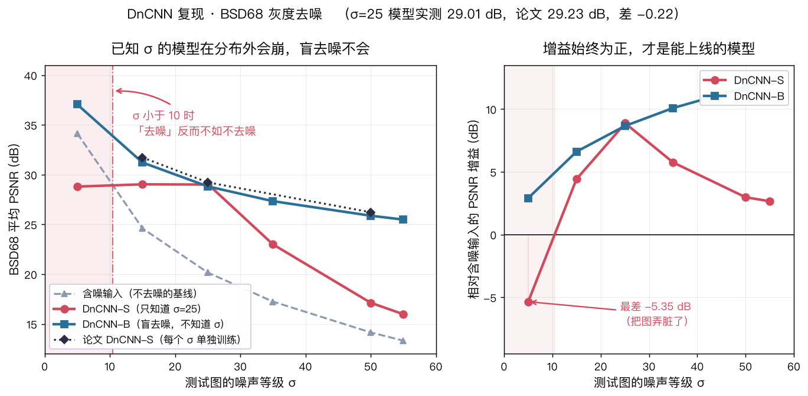
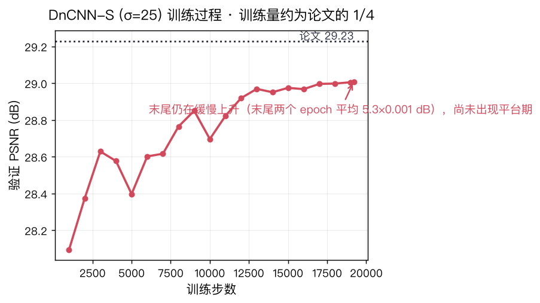
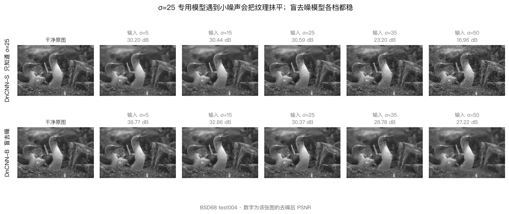

# DnCNN 复现：已知噪声级 vs 盲去噪的鲁棒性对照

复现 [Zhang et al., *Beyond a Gaussian Denoiser: Residual Learning of Deep CNN for Image Denoising*](https://arxiv.org/abs/1608.03981)（TIP 2017），
在 Apple Silicon 上从零训练 DnCNN-S 与 DnCNN-B，并测量两者在**训练分布之外**的表现差异。



## 结论

**1. 复现本身成立。** 已知噪声级 σ=25 的 DnCNN-S 在 BSD68 上拿到 **29.01 dB**，论文 29.23 dB，
差 **−0.22 dB**，而训练量只有论文的 **1/4**（2.75 小时）。验证 PSNR 到最后一个 epoch 仍在上升、
没有平台期，说明差距来自欠训练而不是实现错误。



**2. 真正有意思的是分布外的表现。** 把这个 σ=25 的模型扔到它没见过的噪声上：

| 输入 σ | 含噪基线 | DnCNN-S (σ=25) | 增益 |
|--:|--:|--:|--:|
| 5 | 34.15 | 28.80 | **−5.35** ❌ |
| 25 | 20.17 | 29.01 | +8.84 |
| 50 | 14.15 | 17.13 | +2.98 |

**σ≈10 以下，"去噪"的结果比不去更差** —— 一张本来就很干净的图被抹平了 5 个 dB。
这是已知噪声级去噪器的典型脆弱性：模型把"噪声"当成了要抹掉的东西。

**3. 盲去噪 DnCNN-B 牺牲不到 0.5 dB，换来全程可用。** 训练时 σ 从 0 随机取到 55 的**单一模型**，
在 5–55 全程保持正增益：



注意上排（DnCNN-S）在 σ=5 时被抹平，和它在 σ=25 时几乎一个样（30.20 vs 30.59 dB）；
下排（盲模型）在同样输入下几乎原封不动地保住了细节（38.77 dB）。
**同一张图、同一份权重，差 8.6 dB。**

## 复现对照：BSD68 灰度（68 张平均 PSNR/dB）

完整表格见 [`results/tables.md`](results/tables.md)（由脚本从结果 JSON 自动生成）。

| 模型 | σ=15 | σ=25 | σ=50 | 说明 |
|:--|--:|--:|--:|:--|
| BM3D（论文） | 31.07 | 28.57 | 25.62 | 传统方法 |
| TNRD（论文） | 31.42 | 28.92 | 25.97 | 传统方法 |
| **DnCNN-S（论文）** | **31.73** | **29.23** | **26.23** | 每个 σ 单独训练，完整训练量 |
| **DnCNN-S（本实现）** | — | **29.01** | — | 只训了 σ=25，1/4 训练量 |
| **DnCNN-B（本实现）** | 31.22 | 28.83 | 25.88 | 单一盲模型，1/4 训练量 |

补充数据：

- 8× 自集成（`--self-ensemble`）：σ=25 提到 **29.07 dB**，代价是 568 ms/张 vs 74 ms/张
- 推理速度（Apple M系列，MPS 后端，481×321 灰度）：DnCNN-S **74.5 ms/张**，DnCNN-B 107.7 ms/张
- 参数量：DnCNN-S **556,096**，DnCNN-B 667,072
- 训练耗时：DnCNN-S 2.75 h，DnCNN-B 3.28 h（均为 19,200 steps，MPS）

## 快速开始

仓库里带了两个训练好的 checkpoint（各约 2 MB），**clone 下来就能跑，不需要训练**：

```bash
git clone <this-repo> && cd dncnn-repro
pip install -r requirements.txt

# 用盲去噪模型去噪自己的图片（自动分块 + 边界羽化，支持任意分辨率；
# 灰度模型处理彩色图时会逐通道独立去噪）
python -m src.denoise --ckpt checkpoints/dncnn_b_blind.pth \
                      --input your_photo.jpg --output clean.jpg --compare

# 想看真实的 PSNR 提升，就一并给出干净原图（没有它只能给噪声估计值）
python -m src.denoise --ckpt checkpoints/dncnn_b_blind.pth \
                      --input noisy.jpg --clean original.jpg --compare

# 在 BSD68 上评测
python download_data.py            # 首次运行需要下载测试集
python -m src.test --ckpt checkpoints/dncnn_s_sigma25.pth \
                   --dataset BSD68 --sigma 25 --merge-bn --fig

# 重画本文所有图（几秒钟，纯读 results/*.json）
python tools/sweep_fig.py
```

从零训练：

```bash
python download_data.py                        # 下载 BSDS500 + BSD68 + Set12
python -m src.train --gray --sigma 25 --preset fast    # 已知噪声级，约 2.75 h
python -m src.train --gray --blind --preset fast      # 盲去噪，约 3.3 h
python tools/make_report.py                    # 结果 JSON -> results/tables.md
```

CPU 可跑，只是慢很多。CUDA / MPS / CPU 自动选择，无需改代码。

## 项目结构

```
src/model.py          DnCNN 网络（depth 17/20、残差学习、零填充、BN 折叠）
src/data.py           patch 采样、测试集加载、PSNR/SSIM、MATLAB 口径 rgb2gray
src/train.py          训练（Adam 1e-4→1e-6 指数衰减；--blind 训DnCNN-B）
src/test.py           评测（PSNR/SSIM、8× 自集成、定性对比图、JSON 结果）
src/denoise.py        推理：对任意图片去噪（单图/批量、分块羽化）
download_data.py      数据下载（断点续传 + 多通道网络容错，见下）
tools/make_report.py  结果 JSON -> results/tables.md
tools/sweep_fig.py    results/*.json -> figures/*.png（本文的图都能一键重画）
tools/curve.py        逐 checkpoint 评估，画「PSNR vs 训练量」曲线
tools/make_figs.py    生成讲义的 16 张配图
tools/lr_sweep.py     实测 (init, optimizer, lr) 组合，定出不会发散的配方
tools/diag.py         一次只改一个变量的对照实验，定位瓶颈
tools/watch.py        实时监控后台训练（几乎不占资源）
tests/                33 个测试，见下
docs/DnCNN讲义.md     面向零基础的原理讲义（2800 行，16 张配图）
checkpoints/          训练好的权重（DnCNN-S σ=25 / DnCNN-B blind）
results/              评测结果 JSON + 自动生成的汇总表 + 训练曲线 CSV
figures/              README 用的图
```

## 测试

```bash
pip install pytest && pytest        # 33 passed
```

测试不只检查"能跑通"，而是钉住那些**错了不会报错、只会让所有 PSNR 静默偏掉**的地方：

| 测试 | 钉住什么 |
|:--|:--|
| `test_merge_bnorm_is_numerically_equivalent` | BN 折叠成 Conv 前后输出必须逐像素一致 |
| `test_rgb2gray_matches_matlab` | 灰度系数必须是 MATLAB 的（红/绿/蓝 → 76/150/29），不是 Rec.709 |
| `test_residual_learning_wiring` | 网络预测的是**噪声**，输出 = 输入 − 网络输出 |
| `test_noise_sigma_is_calibrated` | 注入噪声的真实标准差必须等于请求的 σ（0–255 尺度） |
| `test_psnr_color_is_mean_over_channels` | 彩色 PSNR 逐通道算再平均，不是一整图算 MSE |
| `test_orthogonal_init_keeps_weights_small` | 中间层卷积核范数是 He 初始化的 1/7 |

其中 BN 折叠那条是有来历的：常见的错误写法是 `b' = (β−μ)·g + b_conv`，
漏了**卷积自身的 bias 也要乘 g**，正确写法是 `b' = g·(b_conv−μ) + β`。
两者在**刚初始化时完全等价**（所有 bias 都是 0），只有训练让 bias 偏离 0 之后才暴露，
所以测试必须主动注入非零 bias 才测得出来——否则它会一直"通过"。

## 实现里几个不显然的点

**网络深度取决于噪声是否已知。** DnCNN-S 用 depth=17，DnCNN-B 用 depth=20（论文 Sec. IV-A）。
checkpoint 里存了训练时的配置，`src/model.py` 的 `load_dncnn()` 按它重建。
把 depth 写死在调用处是这个项目最容易犯的错，加载盲模型时会 shape mismatch。

**论文的超参不能直接抄。** 正文用的是 MatConvNet 上的 SGD + lr 1e-1；
直接照搬到 PyTorch 会发散。作者官方 PyTorch 实现（KAIR）实际用的是 Adam 1e-4，
本项目默认即 Adam。正交初始化 + gain 0.2 也是 MatConvNet 的默认值，
它让中间层卷积核范数只有 He 初始化的 1/7，这是论文那个大学习率能训起来的前提。

**BN 折叠必须从后往前遍历。** 把 `layers[i+1]` 换成 `Identity` 时，
若正序遍历会导致索引错位、漏合并后面的层。

**`download_data.py` 处理了四种网络环境。** `raw.githubusercontent.com` 不通时自动改用
`api.github.com` 的 contents 接口；撞上匿名限流（60 次/小时）时自动等配额重置，
超过 15 分钟才提示配 token；没有 CA 证书时自动改用系统 `curl`；
或者 `--tarball` 一次请求拿整仓。全程可断点续传。

**灰度转换用 MATLAB 系数而不是 skimage 默认值。**
`Y = 0.2989R + 0.5870G + 0.1140B`，不是 Rec.709 的 0.2126/0.7152/0.0722。
换成 Rec.709 会让所有 PSNR 偏掉约 0.1 dB——足以让"复现成功"的判定翻车。

## 局限

诚实列一下这个仓库**没有**做到的事：

- **只训了 σ=25 的已知噪声级模型。** 论文 Table II 的 σ=15 / σ=50 两行没有复现，
  所以对照表里 DnCNN-S 那两格是空的。补齐需要再约 5.5 小时训练。
- **−0.22 dB 超出我自己定的 ±0.15 dB 成功线。** 证据（收敛曲线无平台）指向欠训练，
  但没有直接证明：没有跑完整配方做对照。
- **没复现彩色 Table III。** 论文 Table III 用的是彩色 Set12，
  而 DnCNN 官方仓库提供的 Set12 是灰度图，两者不是同一份数据。
- **σ=5/15/35/50/55 上"已知-σ 模型"的数字不能当作复现结果。**
  它们是用 σ=25 的模型去测的，属于分布外探测，对照意义在第 2 节那张表里已经讲清楚了。
- **8× 自集成只测了 σ=25**，没有全档位扫。

## 引用

```bibtex
@article{zhang2017beyond,
  title={Beyond a Gaussian Denoiser: Residual Learning of Deep {CNN} for Image Denoising},
  author={Zhang, Kai and Li, Yulun and Zuo, Wenlei and Zhang, Lin and Van Gool, Luc},
  journal={IEEE Transactions on Image Processing},
  year={2017}
}
```

数据来自 [BIDS/BSDS500](https://www2.eecs.berkeley.edu/Research/Projects/CS/vision/grouping/BSR/)
与 [cszn/DnCNN](https://github.com/cszn/DnCNN) 官方测试集，均未包含在本仓库中。

## 许可

代码 [MIT](LICENSE)。

数据集版权归各自作者所有，**本仓库不包含任何数据集文件**，只提供 `download_data.py` 下载脚本：

- BSDS500 / BSD400 — [BIDS](https://www2.eecs.berkeley.edu/Research/Projects/CS/vision/grouping/BSR/)
- BSD68、Set12 — [cszn/DnCNN](https://github.com/cszn/DnCNN) 官方测试集